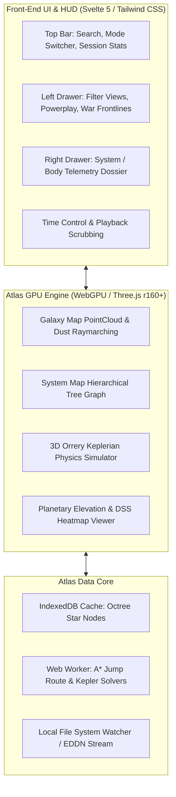

# Atlas - High-Performance Elite Dangerous Web Cartography
**Mission Statement:**  
Atlas is a slim, ultra-fast, GPU-accelerated web viewer for Elite Dangerous cartography. It delivers pixel-accurate recreation of the in-game Galaxy Map, System Map, Planetary Surface Map, and 3D Orrery, matching the Cobra Engine's iconic orange HUD aesthetic, icon styling, and camera kinematics, while offering modern, responsive 120+ FPS performance.

---

## 1. Core Principles & Philosophy
1. **Zero Bloat / Maximum Framerate:**  
   Built on WebGPU + Svelte 5 / TypeScript. No heavy frameworks, no virtual DOM reconciliation bottlenecks. Pure hardware-accelerated compute shaders and instanced geometry.
2. **Faithful Visual Parity:**  
   Exact reproductions of Frontier's UI layouts, font metrics, sound stingers (optional), reticles, projection stalks, and vector icons extracted from game files.
3. **Seamless Multi-Map Continuity:**  
   Instant fluid transitions: **Galaxy View $\leftrightarrow$ System Hierarchy $\leftrightarrow$ 3D Keplerian Orrery $\leftrightarrow$ Planetary Surface**.
4. **Offline & Live Dual-Mode:**  
   * *Offline / Archival Mode:* Browse catalog stars, historical systems, and routes.
   * *Live Telemetry Mode:* Connects directly to local player journal logs (`Saved Games`) or EDDN live data stream for active flight tracking.

---

## 2. System Architecture

---

## 3. Project Directory Map
* [`atlas/`](.)
  * [`client/`](client): Svelte 5 + WebGPU cartography web application (`npm run dev` / `npm run build`).
  * [`docs/`](docs): Architectural blueprints, shader specs, and data pipelines.
  * [`docs/player_account_database_architecture.md`](docs/player_account_database_architecture.md): Dedicated private `playerdb.db` schema and AES-256-GCM token vault.
  * [`roadmap/`](roadmap): Phase-by-phase implementation schedule, specifications, and milestones.
  * [`roadmap/STAGES.md`](roadmap/STAGES.md): Active live stage tracker (Phases 1–20, 80 atomic stages).
  * [`specs/`](specs): Mathematical formulas, Ananke API directories, CAPI authentication, and covert security telemetry.
  * [`specs/social_hardware_and_competitive_features.md`](specs/social_hardware_and_competitive_features.md): WebHID flight stick calibration, HUD color matrix studio, Buckyball racing, and squadron diplomacy.
  * [`specs/advanced_nextgen_innovations.md`](specs/advanced_nextgen_innovations.md): WebXR spatial hologram, WebRTC wing tactical link, procedural audio engine, and BGS war predictors.
  * [`specs/native_client_and_web_integration.md`](specs/native_client_and_web_integration.md): Bidirectional local bridge, reverse waypoint injection, and telemetry logging architecture.
  * [`specs/complete_peripheral_tools_replacement.md`](specs/complete_peripheral_tools_replacement.md): Total consolidation replacing ICARUS Terminal, EDCo-Pilot, edtools, Elite BGS, and EDSM.
  * [`specs/community_tools_replacement_blueprint.md`](specs/community_tools_replacement_blueprint.md): Complete architecture to replace Inara, Spansh, Coriolis/EDSY, EDMC, Canonn, and Raven Colonial.
  * [`specs/community_features_gap_analysis.md`](specs/community_features_gap_analysis.md): Deep feature catalog covering gaps across existing tools.
  * [`specs/deep_security_and_anti_cloning.md`](specs/deep_security_and_anti_cloning.md): Frontier CAPI OAuth2 linkage, PoW bot defense, and IP protection.
  * [`specs/covert_phone_home_telemetry.md`](specs/covert_phone_home_telemetry.md): Covert anti-clone traps and direct alerting (standalone, without The Orb).
  * [`design_system/`](design_system): Theme tokens, typography, colors, and audio/UI styling.
  * [`assets/`](assets): Pixel-perfect SVG vector icons, shaders, and materials.

---

## 4. Ecosystem Integration

Atlas integrates seamlessly across the Elite Dangerous instrumentation ecosystem:
- **[Ananke](../ananke)**: High-performance Rust Axum spatial engine (`:8000`) for 3D R*Tree cube queries, A* routing, and live EDDN market feeds.
- **[EDill](../EDill)**: Host proxy loader & Named Pipe bridge (`:8999`) for bidirectional live telemetry and target injection.
- **[EdEzCheese](../EdEzCheese)**: In-game D3D11 HUD overlay payload (`delphi.dll`) with multi-box VFS journal isolation.
- **[EDLibary](../EDLibary)**: Technical reverse-engineering codex covering Cobra engine structures and protocols.
