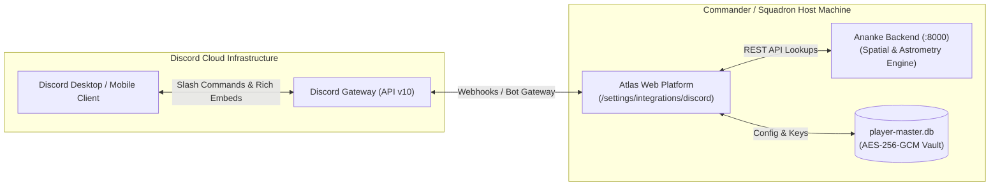

# AtlasBot — User-Side Discord Bot Integration & Setup Guide
**Document ID:** `ATLAS-DOC-ATLASBOT-01`  
**Classification:** Operational Guide & End-User Configuration Manual  
**Target Environment:** Discord API v10 | Atlas Web Super-Platform | Ananke Backend  

---

## 1. Executive Overview & Architecture
`AtlasBot` is the dedicated Discord companion bot for the Atlas ecosystem. Built entirely as a user-side, self-hosted or self-configured integration, AtlasBot connects your personal Discord server or Squadron War Room directly to Atlas and the Ananke galactic spatial engine (`http://127.0.0.1:8000`).

Unlike centralized third-party bots with questionable data ownership or potential downtimes, AtlasBot is powered through your personal Discord Application token or webhook URLs. You retain complete control over your bot credentials, server permissions, and data privacy.

---

## 2. Step-by-Step Setup Guide for Commanders & Squadrons

### Step 1: Create a Discord Application
1. Navigate to the [Discord Developer Portal](https://discord.com/developers/applications).
2. Log in with your Discord account.
3. Click the **New Application** button in the top right corner.
4. Set the name to **`AtlasBot`** (or your squadron's custom variant, e.g. `AtlasBot - [SQUAD]`).
5. Accept the Developer Terms of Service and click **Create**.
6. *(Optional)* Upload the official Atlas Cobra Amber icon to the application avatar.

### Step 2: Configure the Bot User
1. In the left sidebar of your application dashboard, click on **Bot**.
2. Under the **Username** field, verify the bot is named `AtlasBot`.
3. Under **Privileged Gateway Intents**, enable:
   - **Server Members Intent** (required for squadron roster syncing).
   - **Message Content Intent** (required if using legacy prefix commands).
4. Click **Save Changes**.

### Step 3: Generate the Bot Token
1. On the same **Bot** page, find the **Token** section.
2. Click **Reset Token** and authenticate (enter your 2FA code if enabled).
3. Click **Copy** to copy the token to your clipboard.
> [!CAUTION]
> Never share your Bot Token publicly or commit it to version control. Treat it like your master password.

### Step 4: Invite AtlasBot to Your Discord Server
1. In the left sidebar, click on **OAuth2** $\rightarrow$ **URL Generator**.
2. Under **Scopes**, select:
   - `bot`
   - `applications.commands` (for interactive slash commands).
3. Under **Bot Permissions**, select:
   - `Send Messages`
   - `Embed Links`
   - `Attach Files`
   - `Read Message History`
   - `Use External Emojis`
4. Copy the generated URL at the bottom of the page, paste it into your browser, select your Discord server, and click **Authorize**.

### Step 5: Link AtlasBot in Atlas Web Settings
1. Open Atlas in your browser (`http://localhost:5173` or your local deployment origin).
2. Navigate to **User Settings** (`/settings`) $\rightarrow$ **Integrations** $\rightarrow$ **Discord (AtlasBot)**.
3. Paste your copied **Bot Token** into the token field (or paste a channel **Webhook URL** for alert-only mode).
4. Select which automated event channels you want enabled (Fleet Carrier Upkeep, Jump Countdowns, BGS Tick Shifts, Thargoid Alerts).
5. Click **Verify & Bind**. Atlas will validate the token against Discord API v10 and confirm active connection status.

---

## 3. Interactive Slash Commands Reference

Once AtlasBot is connected, members of your Discord server can use interactive slash commands powered directly by Ananke:

| Command | Arguments | Description | Example |
| :--- | :--- | :--- | :--- |
| `/system` | `<name>` | Query stellar coordinates, allegiance, economy, security, body count, and Thargoid war state. | `/system Sol` |
| `/station` | `<name>` | Look up starport facilities, landing pad sizes (`[S, M, L]`), market freshness, and distance to arrival. | `/station Jameson Memorial` |
| `/commodity` | `<name> [near]` | Find lowest sell prices and highest buy prices within range via Ananke market index. | `/commodity Tritium near:Sol` |
| `/route` | `<origin> <dest> [range]` | Plot fastest A* or 4x Neutron Highway route with fuel scoop stops directly in chat. | `/route Sol Colonia range:65` |
| `/status` | `[cmdr]` | Display verified commander status, current system, active ship loadout, and fleet carrier balances. | `/status CMDR Jameson` |
| `/bgs` | `<system>` | Display faction influence percentages, state transitions (Election, War, Boom), and pending daily tick. | `/bgs Shinrarta Dezhra` |
| `/carrier` | `<callsign>` | Inspect remote carrier status, current system, tritium fuel tank %, and docking access rules. | `/carrier V3Z-88Q` |

---

## 4. Automated Discord Rich Embed Alerts

AtlasBot automatically dispatches structured, color-coded Discord rich embeds for critical game events:

1. **Fleet Carrier Jump Countdown:** Dispatched 15m, 5m, and upon jump completion with departure and destination system coordinates.
2. **Low Tritium Alert:** Warns squadron logistics officers when carrier fuel drops below 100 tonnes.
3. **Daily BGS Tick Notification:** Broadcasts the daily galactic BGS influence shift and faction delta percentages across squadron systems.
4. **Thargoid War Frontline Updates:** Real-time alert when a defended system flips from Alert to Invasion, or when a Titan Maelstrom vent window opens.
5. **High-Value Discovery Notification:** Alerts explorers when an undiscovered Earth-Like World (ELW) or high-payout biological specimen is registered.
