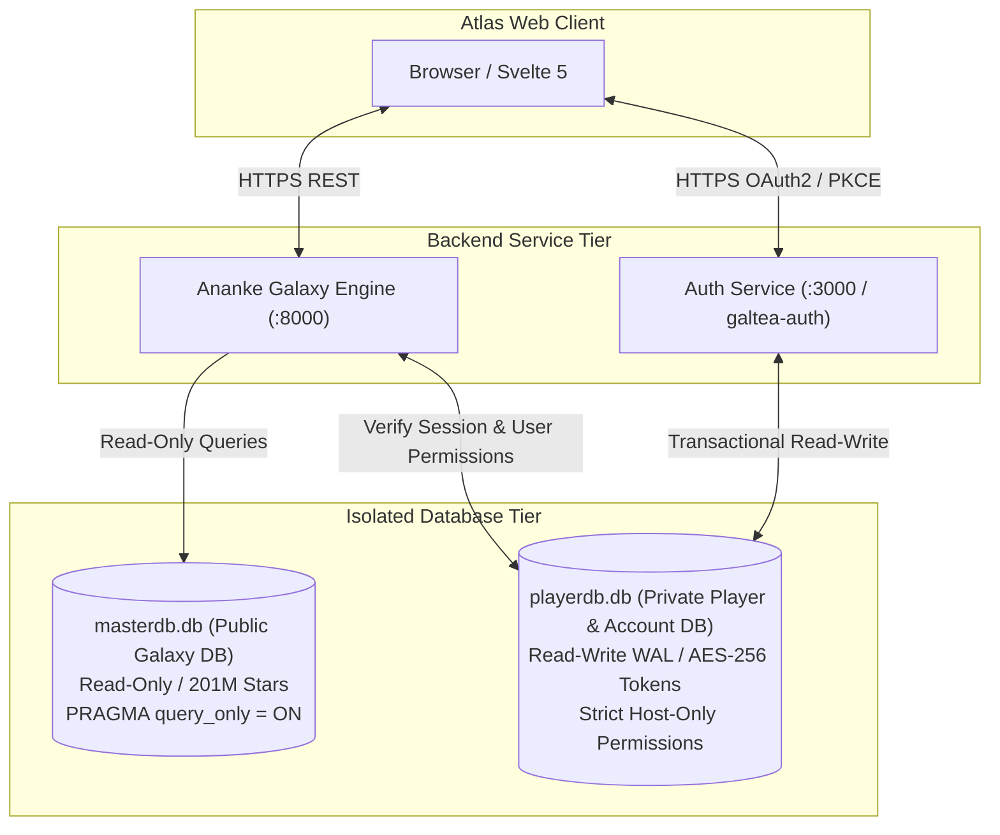

# Atlas - Dedicated Player & Account Database Architecture (`playerdb.db`)
**Document ID:** `ATLAS-DB-PLAYER-ACCOUNT-01`  
**Classification:** Database Architecture & Security Specification  
**Architectural Separation:**  
* **Galaxy Database (`masterdb.db` / `edsm_cube.db`):** Shared, public, read-only (`PRAGMA query_only = ON;`).
* **Player & Account Database (`playerdb.db`):** Private, isolated, read-write, encrypted-at-rest token vault.

---

## 1. Architectural Rationale for Database Isolation

Separating player and account data into a dedicated database (`playerdb.db`) provides critical security and operational guarantees:

1. **Strict Defense-in-Depth & Token Isolation:**
   * Frontier CAPI access/refresh tokens and OAuth secrets must never reside in the public-facing or read-only galaxy catalog database.
   * If a read vulnerability or query leak occurs in galaxy search, sensitive player tokens and account profiles remain physically isolated.
2. **Read-Only Invariant Preservation:**
   * `masterdb.db` remains 100% read-only (`PRAGMA query_only = ON`), ensuring zero write-lock contention across millions of spatial searches.
   * `playerdb.db` operates in SQLite WAL mode dedicated to transactional player writes (bookmarks, fleet sync, CAPI token refreshes, squadron claims).
3. **Independent Backup & GDPR Compliance:**
   * Player data can be backed up with separate cryptographic keys and retention policies.
   * "Right-to-be-forgotten" (GDPR) deletions touch only `playerdb.db` without altering the monolithic 200M+ star catalog.



---

## 2. Security & Encryption Standards

1. **Token Vault Encryption:**
   * CAPI access tokens, refresh tokens, and session secrets are encrypted at rest using **AES-256-GCM**.
   * Encryption keys are injected via server environment variables (`PLAYER_DB_VAULT_KEY`) and are never written to disk or database tables.
2. **File System Permissions:**
   * `playerdb.db` file permissions are restricted to the service user (`chmod 600` / Windows ACL restricted to service account).
3. **Foreign Key Integrity:**
   * Foreign keys in `playerdb.db` reference star systems and bodies by `id64` (stored as `TEXT` to guarantee precision) without direct foreign-key constraints to `masterdb.db`, maintaining true loose coupling.

---

## 3. Dedicated Database Schema (`playerdb.db`)

### 3.1 Account Identity & Authentication Vault (`accounts`)
Stores verified Frontier identities linked via OAuth2 / PKCE:
```sql
CREATE TABLE IF NOT EXISTS accounts (
    account_id TEXT PRIMARY KEY,               -- Internal UUID v4
    frontier_fid TEXT UNIQUE NOT NULL,         -- Official Frontier Customer ID (FID)
    cmdr_name TEXT NOT NULL,                   -- Official Commander Name
    email_hash TEXT NOT NULL,                  -- SHA-256 hashed email for account linking
    role TEXT DEFAULT 'commander',             -- 'commander', 'squadron_leader', 'admin'
    created_at INTEGER NOT NULL,               -- Epoch timestamp (UTC)
    last_login_at INTEGER NOT NULL,            -- Epoch timestamp (UTC)
    account_status TEXT DEFAULT 'active'       -- 'active', 'suspended', 'deleted'
);
CREATE INDEX IF NOT EXISTS idx_accounts_cmdr ON accounts(cmdr_name COLLATE NOCASE);
CREATE INDEX IF NOT EXISTS idx_accounts_fid ON accounts(frontier_fid);
```

### 3.2 CAPI Token Vault (`capi_tokens`)
Encrypted credentials managed exclusively by the authentication service:
```sql
CREATE TABLE IF NOT EXISTS capi_tokens (
    account_id TEXT PRIMARY KEY,
    encrypted_access_token BLOB NOT NULL,      -- AES-256-GCM cipher bytes
    encrypted_refresh_token BLOB NOT NULL,     -- AES-256-GCM cipher bytes
    token_nonce BLOB NOT NULL,                 -- 12-byte GCM initialization vector
    token_tag BLOB NOT NULL,                   -- 16-byte GCM authentication tag
    token_expiry_timestamp INTEGER NOT NULL,   -- Epoch expiry (typically 3600s)
    last_rolled_timestamp INTEGER NOT NULL,    -- Last 30-minute self-roll
    FOREIGN KEY (account_id) REFERENCES accounts(account_id) ON DELETE CASCADE
);
```

### 3.3 Active Commander Profile & Game State (`cmdr_profiles`)
Synced periodically from Frontier CAPI `/profile`:
```sql
CREATE TABLE IF NOT EXISTS cmdr_profiles (
    account_id TEXT PRIMARY KEY,
    credits INTEGER NOT NULL DEFAULT 0,
    loan INTEGER NOT NULL DEFAULT 0,
    rank_combat INTEGER DEFAULT 0,             -- 0 (Harmless) to 13 (Elite V)
    rank_trade INTEGER DEFAULT 0,              -- 0 (Penniless) to 13 (Elite V)
    rank_explore INTEGER DEFAULT 0,            -- 0 (Aimless) to 13 (Elite V)
    rank_cqc INTEGER DEFAULT 0,
    rank_soldier INTEGER DEFAULT 0,            -- Odyssey On-Foot Mercenary
    rank_exobiologist INTEGER DEFAULT 0,       -- Odyssey Exobiologist
    rank_empire INTEGER DEFAULT 0,             -- Imperial Navy Rank (0 to 14)
    rank_federation INTEGER DEFAULT 0,         -- Federal Navy Rank (0 to 14)
    current_system_id64 TEXT,                  -- Last known star system
    current_ship_id INTEGER,                   -- Active ship ID
    last_synced_timestamp INTEGER NOT NULL,
    FOREIGN KEY (account_id) REFERENCES accounts(account_id) ON DELETE CASCADE
);
```

### 3.4 Commander Shipyard & Fleet Ledger (`cmdr_ships`)
Synced from CAPI `/fleetcarrier` and `/profile`:
```sql
CREATE TABLE IF NOT EXISTS cmdr_ships (
    ship_record_id TEXT PRIMARY KEY,           -- UUID
    account_id TEXT NOT NULL,
    game_ship_id INTEGER NOT NULL,             -- Frontier internal ship index
    ship_type TEXT NOT NULL,                   -- 'anaconda', 'python_nx', 'cutter'
    ship_name TEXT,                            -- Custom user ship name
    ship_ident TEXT,                           -- Custom user tail number
    value_hull INTEGER DEFAULT 0,
    value_modules INTEGER DEFAULT 0,
    rebuy INTEGER DEFAULT 0,
    current_station_id64 TEXT,                 -- Where ship is docked
    current_system_id64 TEXT,
    is_active INTEGER DEFAULT 0,               -- 1 if currently piloting
    loadout_json TEXT,                         -- Full module outfitting blob
    updated_at INTEGER NOT NULL,
    FOREIGN KEY (account_id) REFERENCES accounts(account_id) ON DELETE CASCADE
);
CREATE INDEX IF NOT EXISTS idx_cmdr_ships_account ON cmdr_ships(account_id);
```

### 3.5 Personal Bookmarks, Notes & Waypoints (`cmdr_bookmarks`)
Enables cloud synchronization of private waypoints across browser sessions:
```sql
CREATE TABLE IF NOT EXISTS cmdr_bookmarks (
    bookmark_id TEXT PRIMARY KEY,              -- UUID
    account_id TEXT NOT NULL,
    system_id64 TEXT NOT NULL,
    body_id INTEGER,
    planetary_lat REAL,
    planetary_lon REAL,
    label TEXT NOT NULL,
    note TEXT,
    category TEXT DEFAULT 'general',           -- 'mining', 'hazard', 'base', 'sight'
    color_hex TEXT DEFAULT '#FF7100',
    created_at INTEGER NOT NULL,
    updated_at INTEGER NOT NULL,
    FOREIGN KEY (account_id) REFERENCES accounts(account_id) ON DELETE CASCADE
);
CREATE INDEX IF NOT EXISTS idx_bookmarks_account ON cmdr_bookmarks(account_id);
```

### 3.6 Squadron Management & Role Permissions (`squadrons` & `squadron_members`)
```sql
CREATE TABLE IF NOT EXISTS squadrons (
    squadron_id TEXT PRIMARY KEY,              -- UUID
    name TEXT UNIQUE NOT NULL,
    tag TEXT UNIQUE NOT NULL,                  -- 4-letter tag (e.g. 'AXIS', 'FUEL')
    leader_account_id TEXT NOT NULL,
    home_system_id64 TEXT,
    allegiance TEXT,                           -- 'Federation', 'Empire', 'Alliance', 'Independent'
    squadron_motto TEXT,
    created_at INTEGER NOT NULL,
    FOREIGN KEY (leader_account_id) REFERENCES accounts(account_id)
);

CREATE TABLE IF NOT EXISTS squadron_members (
    squadron_id TEXT NOT NULL,
    account_id TEXT NOT NULL,
    rank TEXT DEFAULT 'member',                -- 'leader', 'officer', 'member', 'recruit'
    joined_at INTEGER NOT NULL,
    PRIMARY KEY (squadron_id, account_id),
    FOREIGN KEY (squadron_id) REFERENCES squadrons(squadron_id) ON DELETE CASCADE,
    FOREIGN KEY (account_id) REFERENCES accounts(account_id) ON DELETE CASCADE
);
```

### 3.7 Personal Fleet Carrier Management (`cmdr_fleet_carriers`)
Synced from CAPI `/fleetcarrier`:
```sql
CREATE TABLE IF NOT EXISTS cmdr_fleet_carriers (
    carrier_callsign TEXT PRIMARY KEY,         -- e.g. 'V4Z-89K'
    account_id TEXT NOT NULL,
    carrier_name TEXT NOT NULL,
    current_system_id64 TEXT NOT NULL,
    current_body_id INTEGER,
    fuel_tritium_tank INTEGER DEFAULT 0,       -- 0 to 1000 tons
    fuel_tritium_cargo INTEGER DEFAULT 0,
    cargo_used INTEGER DEFAULT 0,
    cargo_capacity INTEGER DEFAULT 25000,
    balance INTEGER DEFAULT 0,
    weekly_upkeep INTEGER DEFAULT 0,
    services_installed_json TEXT,              -- Refuel, Repair, Armory, Shipyard, Universal Cartographics
    is_docking_allowed TEXT DEFAULT 'all',     -- 'all', 'squadron', 'friends', 'none'
    notorious_access INTEGER DEFAULT 0,        -- 0 = No outlaws, 1 = Outlaws allowed
    last_synced_timestamp INTEGER NOT NULL,
    FOREIGN KEY (account_id) REFERENCES accounts(account_id) ON DELETE CASCADE
);
CREATE INDEX IF NOT EXISTS idx_carrier_account ON cmdr_fleet_carriers(account_id);
```

### 3.8 Horizons Ship Engineering Materials Inventory (`cmdr_materials_horizons`)
Synced from CAPI `/profile` or journal `Materials.json`:
```sql
CREATE TABLE IF NOT EXISTS cmdr_materials_horizons (
    account_id TEXT NOT NULL,
    category TEXT NOT NULL,                    -- 'raw', 'manufactured', 'encoded'
    material_name TEXT NOT NULL,               -- e.g. 'iron', 'selenium', 'biotechconductors'
    grade INTEGER NOT NULL,                    -- 1 to 5
    count INTEGER NOT NULL DEFAULT 0,
    updated_at INTEGER NOT NULL,
    PRIMARY KEY (account_id, category, material_name),
    FOREIGN KEY (account_id) REFERENCES accounts(account_id) ON DELETE CASCADE
);
CREATE INDEX IF NOT EXISTS idx_horizons_mats ON cmdr_materials_horizons(account_id, category);
```

### 3.9 Odyssey On-Foot Locker & Data Inventory (`cmdr_materials_odyssey`)
Synced from CAPI `/profile` or journal `ShipLocker.json` (1000 cap):
```sql
CREATE TABLE IF NOT EXISTS cmdr_materials_odyssey (
    account_id TEXT NOT NULL,
    category TEXT NOT NULL,                    -- 'data', 'asset_chemical', 'asset_circuit', 'asset_tech', 'good'
    item_name TEXT NOT NULL,                   -- e.g. 'weaponschematic', 'manufacturinginstructions'
    count INTEGER NOT NULL DEFAULT 0,
    updated_at INTEGER NOT NULL,
    PRIMARY KEY (account_id, category, item_name),
    FOREIGN KEY (account_id) REFERENCES accounts(account_id) ON DELETE CASCADE
);
CREATE INDEX IF NOT EXISTS idx_odyssey_mats ON cmdr_materials_odyssey(account_id, category);
```

### 3.10 Odyssey Ground Suits & Handheld Weapons (`cmdr_odyssey_loadouts`)
```sql
CREATE TABLE IF NOT EXISTS cmdr_odyssey_loadouts (
    loadout_id TEXT PRIMARY KEY,               -- UUID
    account_id TEXT NOT NULL,
    item_type TEXT NOT NULL,                   -- 'suit' or 'weapon'
    item_name TEXT NOT NULL,                   -- 'tacticalsuit_class1' (Dominator), 'wpn_m_assaultrifle' (Karma L-6)
    grade INTEGER DEFAULT 1,                   -- G1 to G5
    custom_name TEXT,
    modifications_json TEXT,                   -- JSON array of 4 applied mods (e.g. ['nightvision', 'combatmovement'])
    updated_at INTEGER NOT NULL,
    FOREIGN KEY (account_id) REFERENCES accounts(account_id) ON DELETE CASCADE
);
CREATE INDEX IF NOT EXISTS idx_odyssey_loadouts_account ON cmdr_odyssey_loadouts(account_id);
```

### 3.11 Engineering Crafting Wishlist & Deficit Targets (`cmdr_engineering_wishlist`)
Enables cloud tracking of player crafting shopping lists:
```sql
CREATE TABLE IF NOT EXISTS cmdr_engineering_wishlist (
    wishlist_id TEXT PRIMARY KEY,              -- UUID
    account_id TEXT NOT NULL,
    target_type TEXT NOT NULL,                 -- 'ship_module' or 'odyssey_suit'
    target_name TEXT NOT NULL,                 -- '5A FSD', 'Artemis Suit'
    blueprint_name TEXT NOT NULL,              -- 'Increased Range', 'Extra Backpack'
    target_grade INTEGER NOT NULL,             -- 1 to 5
    rolls_estimated INTEGER DEFAULT 3,
    status TEXT DEFAULT 'active',              -- 'active', 'completed', 'archived'
    created_at INTEGER NOT NULL,
    FOREIGN KEY (account_id) REFERENCES accounts(account_id) ON DELETE CASCADE
);
CREATE INDEX IF NOT EXISTS idx_wishlist_account ON cmdr_engineering_wishlist(account_id);
```

### 3.12 Player Activity, CAPI Action & Security Audit Log (`account_audit_logs`)
Cryptographically records sensitive player actions (colonisation claims, CAPI link/unlink, permission changes) for anti-cheat and security verification:
```sql
CREATE TABLE IF NOT EXISTS account_audit_logs (
    audit_id INTEGER PRIMARY KEY AUTOINCREMENT,
    account_id TEXT NOT NULL,
    action_type TEXT NOT NULL,                 -- 'CAPI_AUTH_LINK', 'TOKEN_ROLL', 'CLAIM_SYSTEM', 'SQUADRON_INVITE'
    target_resource TEXT,                      -- system_id64 or carrier_callsign
    client_ip TEXT NOT NULL,
    user_agent TEXT,
    signature_hash TEXT NOT NULL,              -- HMAC-SHA256 signature
    recorded_at INTEGER NOT NULL,
    FOREIGN KEY (account_id) REFERENCES accounts(account_id) ON DELETE CASCADE
);
CREATE INDEX IF NOT EXISTS idx_audit_account ON account_audit_logs(account_id);
CREATE INDEX IF NOT EXISTS idx_audit_action ON account_audit_logs(action_type);
```


---

## 4. Connection & Concurrency Configuration

`playerdb.db` uses SQLite WAL mode tuned for authenticated transactional read-writes:

```sql
PRAGMA journal_mode = WAL;          -- Write-Ahead Logging for high-concurrency writes
PRAGMA synchronous = NORMAL;        -- Safe fsync on checkpoints with maximum throughput
PRAGMA foreign_keys = ON;           -- Enforce cascading deletions on user account purge
PRAGMA busy_timeout = 5000;         -- 5-second wait before SQLITE_BUSY on locks
PRAGMA cache_size = -16000;         -- 16 MB dedicated memory cache
```

---

## 5. Security & Isolation Matrix

| Characteristic | `masterdb.db` (Galaxy DB) | `playerdb.db` (Player & Account DB) |
| :--- | :--- | :--- |
| **Data Scope** | Public astrometrics, stars, bodies, stations | Private CAPI tokens, player fleet, bookmarks, squadron roles |
| **Access Mode** | Strict Read-Only (`PRAGMA query_only = ON`) | Read-Write (`journal_mode = WAL`) |
| **Token Storage** | None (Zero sensitive data) | AES-256-GCM encrypted binary tokens with unique nonces |
| **Coupling** | Completely standalone | References galaxy systems by `id64` string without FK constraints |
| **GDPR Compliance** | Public game data; no PII | 1-click cascading account purge via `ON DELETE CASCADE` |
