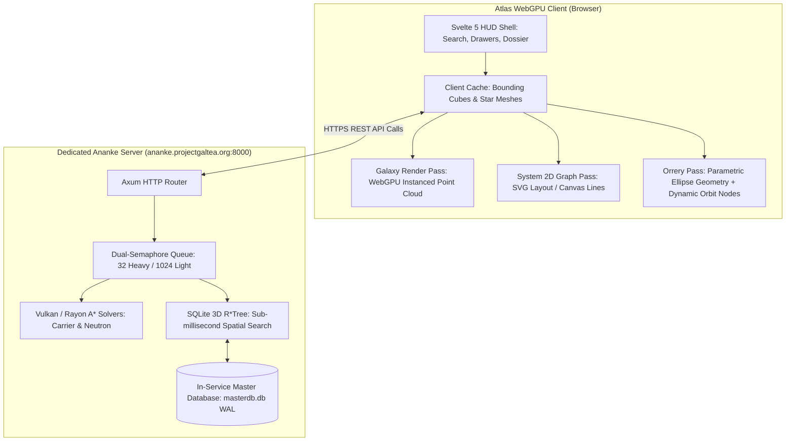

# Atlas - Technical Architecture & Engine Specification
**Target Platform:** Web (Desktop & Tablet), WebXR (VR HUD)  
**Technology Baseline:** TypeScript, WebGPU (Three.js `WebGPURenderer` / WGSL), Svelte 5  
**Backend Services:** Dedicated External Ananke Rust Galaxy Engine (`https://ananke.projectgaltea.org` / Port `8000`)

---

## 1. Engine Subsystems Overview

Atlas operates as a **slim, ultra-fast WebGPU cartography frontend**, consuming data via high-performance REST APIs from the dedicated external **Ananke Galaxy Engine**:



---

## 2. WebGPU Rendering Pipeline

The client browser focuses exclusively on **GPU rendering performance** (60–144+ FPS):

### 2.1 Galaxy Star Point Shaders (WGSL / GLSL)
Stars are rendered using an instanced point cloud with quadratic limb-darkening:
```wgsl
struct VertexOutput {
    @builtin(position) position: vec4<f32>,
    @location(0) color: vec3<f32>,
    @location(1) uv: vec2<f32>,
    @location(2) size: f32,
};

@fragment
fn fs_star(in: VertexOutput) -> @location(0) vec4<f32> {
    let dist = length(in.uv - vec2<f32>(0.5, 0.5)) * 2.0;
    if (dist > 1.0) {
        discard;
    }
    // Quadratic Limb Darkening + Center Bloom
    let intensity = pow(1.0 - dist, 1.8);
    let glow = pow(1.0 - dist, 4.0) * 0.5;
    let finalColor = in.color * intensity + vec3<f32>(1.0, 1.0, 1.0) * glow;
    return vec4<f32>(finalColor, intensity);
}
```

### 2.2 Client-Side Keplerian Orbit Propagation
While celestial body attributes are retrieved via `GET /api/system/bodies` from Ananke, the client computes smooth real-time orbital movement locally on the rendering thread:
$$E_{n+1} = E_n - \frac{E_n - e \sin E_n - M}{1 - e \cos E_n}$$
This ensures the 3D Orrery time scrubber runs at 144 FPS with zero network roundtrips during time manipulation.

---

## 3. Communication & Ingestion Pipeline

### 3.1 External Ananke API Integration
The client communicates via the typed TypeScript wrapper ([`ananke_client.ts`](file:///D:/Elite%20dangerous%20research/atlas/client/src/lib/engine/ananke_client.ts)):
* **`ananke.searchAutocomplete(query)`** $\rightarrow$ `GET /api/search`
* **`ananke.getCubeSystems(x, y, z, size)`** $\rightarrow$ `GET/POST /api/cube-search`
* **`ananke.getSystemBodies(systemName)`** $\rightarrow$ `GET /api/system/bodies`
* **`ananke.calculateCarrierRoute(source, target, cargoMass)`** $\rightarrow$ `POST /api/carrier-route`
* **`ananke.calculateNeutronRoute(source, target, jumpRange)`** $\rightarrow$ `POST /api/neutron-route`
* **`ananke.getHeatmapUrl()`** $\rightarrow$ `GET /api/heatmap.png`

### 3.2 Local Player Telemetry (Optional Companion Mode)
* Watches local journal logs via the HTML5 File System Access API (`window.showDirectoryPicker()`).
* Detects in-game jumps (`FSDJump`) and automatically centers the 3D Galaxy Map on the player's new position.
