# Atlas - Definitive Master Engineering Roadmap (Phases 1–20)
**Version:** 5.0.0 Definitive Blueprint  
**Scope:** 100% comprehensive, zero-gap execution roadmap covering all 20 specification documents, 5 architectural blueprints, 135 Ananke endpoints, CAPI player persistence (`playerdb.db`), native client bridging, hardware peripherals, and public developer APIs.

---

## 1. Complete 20-Phase Architectural Breakdown

To build out **every single documented feature, peripheral, and system** in Atlas, the project is structured across **20 dedicated engineering phases** following the Golden Ratio standard (**4 atomic stages per phase = 80 stages total**, with ~280 discrete tasks):

```mermaid
flowchart TD
    subgraph Tier1_Foundations ["Tier 1: Core Engine & Visuals (Phases 1-4)"]
        P01["Phase 01: Core Foundations & Cobra HUD Shell"]
        P02["Phase 02: WebGPU 3D Galaxy Engine & Streaming"]
        P03["Phase 03: 2D System Hierarchy & 3D Keplerian Orrery"]
        P04["Phase 04: Visual Navigation Suite & Ananke Routing"]
    end

    subgraph Tier2_Community ["Tier 2: Community Sites Replacement (Phases 5-8)"]
        P05["Phase 05: Exploration, Galactic Heatmaps & DSSA"]
        P06["Phase 06: Live Trade Router & Commodity Engine"]
        P07["Phase 07: In-Browser Shipbuilder & Thermal Simulator"]
        P08["Phase 08: Fleet Carrier Operations & Colonisation Hub"]
    end

    subgraph Tier3_Identity ["Tier 3: Identity, Fleet & Cockpit (Phases 9-12)"]
        P09["Phase 09: CAPI Linkage, CMDR Dossier & Fleet Ledger"]
        P10["Phase 10: Odyssey Ground Engineering & Locker Barter"]
        P11["Phase 11: Web-Native Journal Sync (Zero-Install EDMC)"]
        P12["Phase 12: In-Cockpit Native Bridge & Glass Cockpit Touch HUD"]
    end

    subgraph Tier4_Specialized ["Tier 4: Underworld, Combat & Peripherals (Phases 13-16)"]
        P13["Phase 13: Frontier Underworld, Black Markets & Material Traders"]
        P14["Phase 14: Anti-Xeno War Room, Titan Tactical & Rescue Logistics"]
        P15["Phase 15: Stream Deck, Gamepad API & Physical Sim-Rig Hardware"]
        P16["Phase 16: In-Browser Predictive AI & Exploration Assistant"]
    end

    subgraph Tier5_SecurityNextGen ["Tier 5: Security, Social & Next-Gen (Phases 17-20)"]
        P17["Phase 17: Deep Defense, Micro-PoW Bot Defense & DRM"]
        P18["Phase 18: Covert Anti-Clone Telemetry Sentinel (NO ORB)"]
        P19["Phase 19: Hardware WebHID Studio, HUD Matrix & Racing"]
        P20["Phase 20: WebXR VR Cockpit Hologram, WebRTC Wing Mesh & Developer SDK"]
    end

    Tier1_Foundations --> Tier2_Community
    Tier2_Community --> Tier3_Identity
    Tier3_Identity --> Tier4_Specialized
    Tier4_Specialized --> Tier5_SecurityNextGen
```

---

## 2. Exhaustive Phase Directory & Document Mapping

| Phase | Title | Document Source | Deliverables & Scope |
| :---: | :--- | :--- | :--- |
| **01** | **Core Foundations & Cobra HUD Shell** | `design_system/theme_tokens.md`, `assets/` | Svelte 5 scaffold, amber HUD tokens (`#FF7100`), SVG sprites, top search bar, collapsible drawers. |
| **02** | **WebGPU 3D Galaxy Engine & Streaming** | `docs/rendering_and_loading_optimization.md`, `docs/technical_architecture.md` | WGSL star shaders, 3D boxel frustum streamer (`POST /api/cube-search`), projection stalks, Powerplay bubbles. |
| **03** | **2D System Hierarchy & 3D Keplerian Orrery** | `client/src/lib/engine/kepler.ts`, `docs/database_architecture.md` | D3 orbital parentage tree, 3D elliptical splines, time-scrubbing timeline slider, DSS surface projection. |
| **04** | **Visual Navigation Suite & Ananke Routing** | `specs/website_features_specification.md`, `ananke/docs/API_ENCYCLOPEDIA.md` | A* glowing route paths, neutron star jet cones, carrier route hops, 1-key clipboard synchronization. |
| **05** | **Exploration, Density Heatmaps & DSSA** | `specs/community_tools_replacement_blueprint.md` (EDAstro/Canonn) | 1024x1024 density heatmap overlay, DSSA permanent carriers, historic expedition paths, Generation Ships audio. |
| **06** | **Live Trade Router & Commodity Engine** | `specs/community_tools_replacement_blueprint.md` (Inara/Spansh Trade) | Single-hop best trade, circular loop router, supply/demand decay gauges, black market smuggling finder. |
| **07** | **In-Browser Shipbuilder & Thermals** | `specs/community_tools_replacement_blueprint.md` (Coriolis/EDSY) | 100% native shipyard builder, thermal dissipation curves, power priority checks, hardpoint convergence. |
| **08** | **Carrier Logistics & Colonisation Studio**| `specs/community_features_gap_analysis.md` (Raven Colonial) | System Map Architect View, construction bill of materials (BOM), carrier Tritium ledger, upkeep forecasts. |
| **09** | **CAPI Linkage, CMDR Dossier & Fleet** | `docs/player_account_database_architecture.md`, `specs/deep_security_and_anti_cloning.md` | Frontier OAuth2/PKCE flow, verified CMDR badge, ranks, multi-station fleet ledger (`playerdb.db`). |
| **10** | **Odyssey Engineering & Locker Barter** | `specs/complete_peripheral_tools_replacement.md` | 1,000-cap locker manager, safe-to-sell clean list, Bartender barter calculator, suit/weapon modding. |
| **11** | **Web-Native Journal Sync (Zero-Install)** | `specs/community_tools_replacement_blueprint.md` (EDMC replacement) | HTML5 File System Access API streaming `Status.json` and `Journal.*.log` directly into web HUD; EDDN push. |
| **12** | **In-Cockpit Native Bridge & Touch HUD** | `specs/native_client_and_web_integration.md`, `specs/complete_peripheral_tools_replacement.md` | Local WebSocket bridge (`:8999`), reverse waypoint injection, iPad/tablet Touch HUD, high-G touchdown guide. |
| **13** | **Underworld, Black Markets & Services**| `specs/frontier_services_and_underworld.md` | Nearest Material Traders (Raw/Enc/Mfg), Tech Brokers, Interstellar Factors (anti-local faction logic). |
| **14** | **Anti-Xeno War Room & Titan Tactical** | `specs/website_features_specification.md`, `specs/community_tools_replacement_blueprint.md` | Titan Maelstrom countdowns, Spire sabotage trackers, Compromised Nav Beacons, station evacuation shuttles. |
| **15** | **Stream Deck & Physical Sim-Rig Hardware**| `specs/hardware_and_ai_intelligence.md` | Elgato Stream Deck LCD key plugin, HTML5 Gamepad API for HOTAS flight stick galaxy pan/tilt/zoom. |
| **16** | **In-Browser Predictive AI Assistant** | `specs/hardware_and_ai_intelligence.md` | Lightweight ONNX Web / WASM neural classifier predicting undiscovered Earth-likes and biological value. |
| **17** | **Deep Defense & Anti-Bot DRM** | `specs/deep_security_and_anti_cloning.md` | Cloudflare Turnstile, in-browser micro-PoW solver (<15ms), dynamic 30s HMAC nonces, session asset decryption. |
| **18** | **Covert Anti-Clone Telemetry Sentinel** | `specs/covert_phone_home_telemetry.md`, `specs/frontend_anti_reverse_engineering.md` | Hidden origin traps, silent camera NaN collapse, disguised font prefetch beacons, direct admin alert (NO ORB). |
| **19** | **Hardware WebHID Studio & Racing Matrix**| `specs/social_hardware_and_competitive_features.md` | WebHID flight stick calibration & curves, 3D HUD color matrix tuner (EDHM parity), Buckyball 3D replayer. |
| **20** | **WebXR VR Hologram & Public Developer API**| `specs/advanced_nextgen_innovations.md`, `specs/api_and_developer_ecosystem.md` | Room-scale 3D VR cockpit table via WebXR, WebRTC wing tactical link, procedural WebAudio, open REST API. |

---

## 3. Quantitative Deliverable Summary
* **Total Engineering Phases:** **20 Phases**
* **Total Atomic Stages:** **80 Stages** (4 stages per phase)
* **Total Concrete Tasks:** **~280 Tasks**
* **Total Coverage:** 100% of all 20 specs, 5 architecture documents, and 135 Ananke endpoints.
