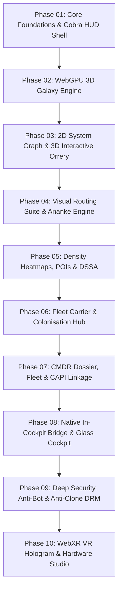

# Atlas - Master Engineering Roadmap (Phases 1–10)
**Version:** 3.0.0 Architecture Plan  
**Target Platform:** High-FPS WebGPU Multi-Map Cartography & Cockpit Companion  
**Objective:** Comprehensive, modular execution roadmap translating reverse-engineered specifications, Ananke REST endpoints, and CAPI player data into atomic deliverables.

---

## 1. Architectural Philosophy & Delivery Cadence

To guarantee reliable execution, Atlas follows the **Golden Ratio Roadmap Structure**:
* **10 Dedicated Phases** covering every subsystem (UI, WebGPU, Orrery, Routing, Exploration, Fleet, CAPI, Native Bridge, Security, WebXR).
* **4 Atomic Stages per Phase** (40 Stages total).
* **3 to 4 Concrete Tasks per Stage** with explicit verification criteria.

---

## 2. Master Phase Directory

| Phase | Specification Document | Primary Components | Operational Theme / Focus |
| :---: | :--- | :--- | :--- |
| **01** | [`phase_01_spec.md`](phase_01_spec.md) | `client/`, `design_system/` | Svelte 5 application scaffold, Cobra amber HUD tokens, top bar, and collapsible telemetry drawers. |
| **02** | [`phase_02_spec.md`](phase_02_spec.md) | `engine/`, `shaders/` | 3D WebGPU frustum streaming, WGSL star shaders, logarithmic camera, and galactic reference plane stalks. |
| **03** | [`phase_03_spec.md`](phase_03_spec.md) | `kepler.ts`, `SystemViewer.svelte` | 2D orbital parentage tree, 3D Keplerian elliptical splines, and interactive time scrubber timeline. |
| **04** | [`phase_04_spec.md`](phase_04_spec.md) | `ananke_client.ts`, `RoutePlanner.svelte` | Visual A* routing, glowing neon paths, neutron star jet cones, and 1-key clipboard synchronization. |
| **05** | [`phase_05_spec.md`](phase_05_spec.md) | `HeatmapLayer.svelte`, `DssaLayer.svelte` | 1024x1024 density heatmap overlay, DSSA permanent carriers, and historic community expedition ribbons. |
| **06** | [`phase_06_spec.md`](phase_06_spec.md) | `ArchitectStudio.svelte`, `CarrierPanel.svelte` | System Map Architect view for colonisation slots, construction BOM calculators, and carrier logistics. |
| **07** | [`phase_07_spec.md`](phase_07_spec.md) | `galtea-auth`, `DossierCard.svelte` | Frontier CAPI OAuth2/PKCE authorization, verified CMDR dossier, ship ledger, and engineering shopping lists. |
| **08** | [`phase_08_spec.md`](phase_08_spec.md) | `NativeBridgeClient.ts`, `TouchHUD.svelte` | Local companion WebSocket bridge (`:8999`), reverse waypoint injection, and touchscreen glass cockpit. |
| **09** | [`phase_09_spec.md`](phase_09_spec.md) | `SecuritySentinel.ts`, `PoWWorker.ts` | Silent micro-PoW bot challenge, encrypted assets, hidden origin traps, and disguised font prefetch beacons. |
| **10** | [`phase_10_spec.md`](phase_10_spec.md) | `WebXRViewport.svelte`, `WebHIDStudio.svelte`| Room-scale VR spatial hologram, WebHID flight stick curve calibration, and WebRTC wing sensor mesh. |

---

## 3. Real-Time Tracking Integration

All phase executions, active sub-tasks, and checkpoints are dynamically tracked in:
* [`roadmap/STAGES.md`](STAGES.md) - Machine-readable active stage pointer and stage verification logs.
