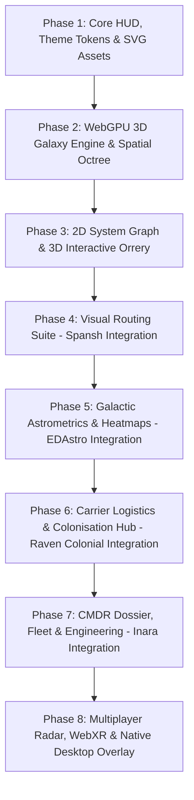

# Atlas - Master Unified Roadmap (All-in-One Community Suite)
**Version:** 2.0.0 Architecture Plan  
**Target:** Unified 120 FPS WebGPU Platform consolidating EDAstro, Inara, Spansh, and Raven Colonial into a cohesive Cobra-themed cartography engine.

---

---

## Phase 1: Core Foundations & Cobra Design System
* [x] Reverse-engineer and catalog all game map states, classes, and localization identifiers.
* [x] Document complete data schema for Galaxy, System, Orrery, and War modes.
* [x] Design System Tokens: CSS variables, fonts, hex palettes, and reticles.
* [x] Extract and author vector spritesheet (`atlas_icon_sprites.svg`).
* [ ] Scaffold project: Vite + Svelte 5 + TypeScript + Tailwind CSS.
* [ ] Construct Cockpit Shell: Top bar, collapsible side drawers, tabular telemetry views.

---

## Phase 2: WebGPU 3D Galaxy Engine
* [ ] WebGPU canvas renderer with fallback to WebGL 2.
* [ ] 5M+ Instanced point cloud stars with physical limb-darkening shader.
* [ ] Morton code (Z-order curve) linear octree for sub-millisecond star streaming.
* [ ] Camera controller: Smooth pan, yaw/pitch rotation, crane elevation, and logarithmic zoom.
* [ ] Authentic perpendicular projection stalks (`StalkBase`) to the $Y = 0$ galactic reference plane.
* [ ] Powerplay 2.0 territory bubbles and Thargoid Titan caustic zones with Fresnel rim lighting.

---

## Phase 3: 2D System Map & 3D Interactive Keplerian Orrery
* [ ] **2D System Map:**
  * Left-to-right orbital parentage layout algorithm (D3 / SVG tree).
  * Planetary body cards with landable crescent arcs and atmospheric ring shaders.
  * Station & settlement miniature pins (Coriolis, Orbis, Outposts, Settlements).
* [ ] **3D Interactive Orrery:**
  * Real-time Keplerian orbital solver ($M = E - e \sin E$) running in Web Worker / Compute.
  * Parametric ellipse splines rendering orbital paths (`THREE.LineLoop`).
  * Time scrubbing timeline slider: Play, pause, accelerate ($1\times, 10\times, 100\times, 1000\times$).
  * Plane snapping camera: automatically aligns to selected planet's orbital inclination.

---

## Phase 4: Visual Routing Suite (Spansh Integration)
* [ ] **Neutron Highway Visualizer:**
  * Ingest and render Spansh Neutron Plotter routes directly in 3D galactic space.
  * Visual jet cones on neutron/white dwarf stars; color-coded fuel-star recovery stops.
  * One-click HUD "Copy Next Waypoint" with clipboard integration for seamless in-game paste.
* [ ] **Road to Riches (Exploration Routefinder):**
  * High-value terraformable water/earth-like planet pathfinder.
  * Scan value estimator calculating projected exploration cartography payout.
* [ ] **Fleet Carrier Multi-Hop Navigator:**
  * Visual 500 LY jump range spheres; tritium consumption calculator and orbital body parking validator.

---

## Phase 5: Galactic Astrometrics & Density Heatmaps (EDAstro Integration)
* [ ] **3D Volumetric Exploration Heatmaps:**
  * GPU raymarched 3D density volume rendering historical Commander exploration tracks.
  * Visual identification of unexplored dark sectors vs. heavily trafficked galactic highways.
* [ ] **Expedition Tracker & Historic POIs:**
  * Deep Space Support Array (DSSA) permanent carrier fleet layer.
  * Historical community expedition paths (Distant Worlds 1 & 2, Sagittarius-Carina Mission).
  * Points of Interest directory: Generation ships, Guardian ruins, Thargoid surface sites, megaships.

---

## Phase 6: Fleet Carrier & Colonisation Logistics (Raven Colonial Integration)
* [ ] **System Map Architect View:**
  * Visual interface for colonisation slots: active, used, and open construction bays.
  * Demolition countdown timers and project progress bars.
* [ ] **Colonisation Supply Chain Optimizer:**
  * Automated bill of materials (BOM) calculator for station construction stages.
  * Spatial market radius search: locates nearest stations with sufficient supply and lowest purchase price.
* [ ] **Carrier Fleet Operations Management:**
  * Remote tritium fuel monitoring, market buy/sell order configuration, and scheduled jump logistics.

---

## Phase 7: Commander Dossier & Engineering Vault (Inara Integration)
* [ ] **Live Ship & Fleet Ledger:**
  * Real-time ship loadout viewer, core/optional modules, engineered experimental effects.
  * Stored ship locator across all starports with transfer time and credit cost calculator.
* [ ] **Engineering Blueprints & Material Vault:**
  * Raw, Manufactured, and Encoded data inventory levels synced directly via Journal.
  * "Wishlist" blueprint calculator: select engineering modifications (e.g., Grade 5 Increased FSD Range) to highlight missing materials and plot collection routes.
* [ ] **BGS & Minor Faction War Room:**
  * Faction influence graphs, conflict zone status, state trends (Boom, War, Civil War, Election).

---

## Phase 8: Multi-Commander Radar, WebXR & Native Desktop Overlay
* [ ] **Multi-Commander Fleet Radar (WebSockets):**
  * Shared real-time tactical map for wings, squadrons, or expedition flotillas.
  * Live wing member position markers and fuel emergency distress beacons (Fuel Rats integration).
* [ ] **WebXR VR Cartography Mode:**
  * Full immersive 3D Galaxy Map navigable via VR motion controllers inside headsets.
* [ ] **Native Desktop Companion Overlay:**
  * Package core using Electron / Tauri as a lightweight transparent desktop overlay on Windows with hotkeys.
