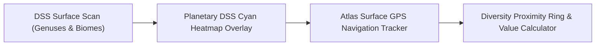

# Atlas - Advanced Ecosystem & Functional Deepening Specification
**Scope:** The remaining critical domains needed to make Atlas the definitive, modern, all-in-one Elite Dangerous platform.

---

## 1. Odyssey Exobiology & Genus Distance Assistant
In Elite Dangerous Odyssey, exobiology is one of the highest-paying exploration activities ($100\text{M}+$ credits per system with First Discovery bonuses), but players face severe mechanical friction:
* Each genus requires 3 genetic samples (`FieldSampler_Scan_NextOrganic`).
* Samples must be collected at specific minimum genetic diversity clone distances (`OrganicPartialSampleTooClose` vs. `OrganicPartialSampleFarEnough`).

### 1.1 Atlas Exobiology Enhancements:
1. **Interactive Planetary DSS Heatmap Viewer:**
   * Overlay the exact planetary organic distribution gradient directly on the 3D globe.
   * Filterable by Genus: `Stratum`, `Tubus`, `Concha`, `Fonticulus`, `Frutexa`, `Bacterium`, `Osseus`, etc.
2. **Genetic Diversity Proximity Compass (GPS):**
   * Reads player ground coordinates `[Latitude, Longitude]` from `Status.json` in real time.
   * Drops a pin on Sample 1 & Sample 2. Renders a dynamic distance radius circle (e.g. $500\text{m}$ for *Stratum*, $100\text{m}$ for *Bacterium*, $800\text{m}$ for *Tubus*) on a mobile/tablet HUD.
   * Alerts the Commander when they have crossed the minimum clone separation boundary (`OrganicPartialSampleFarEnough`).
3. **Cartographic Vista Genomics Payout Calculator:**
   * Calculates total system payout including the $4\times$ ($5\times$ total) First Logged Discovery multiplier.

---

## 2. Integrated Audio & Synthetic COVAS Flight Assistant
Frontier's Cobra audio design is world-class. Integrating sound elevates Atlas from a static database into an authentic flight computer:
1. **UI Sound FX Engine (Web Audio API):**
   * Synthesize or play Frontier's characteristic short UI blips on hover, system selection, drawer expansion, and route plotting.
2. **Synthetic COVAS Voice Synthesis (Web Speech API / Neural TTS):**
   * Speaks navigation callouts:
     * *"Route calculated: 14 jumps to destination."*
     * *"Warning: Next jump system is an unscoopable star class T-Tauri."*
     * *"High-value terraformable water world detected in system."*
     * *"Carrier jump confirmed: Departure in 14 minutes."*

---

## 3. Real-Time Supercruise & Orbital Flight Telemetry
When flying in-game, Commanders frequently overshoot stations (the "Loop of Shame") or miscalculate orbital drop angles.
1. **Live Orbital Flight Glide Assistant:**
   * Reads altitude, heading, pitch, and surface gravity $g$ from `Status.json`.
   * Displays the optimal glide corridor window ($-5^\circ$ to $-60^\circ$ pitch) on the tablet companion.
2. **Supercruise Distance & ETA Tracker:**
   * Visualizes distance to destination in light-seconds (LS) and computes the exact deceleration curve required to maintain the "6-second rule".

---

## 4. Multi-Commander Squadron Logistics & Expedition Flotillas
Beyond solo exploration, major expeditions (Distant Worlds, BGS operations, Powerplay defense) require group synchronization:
1. **Shared Fleet Waypoints:**
   * Expedition leaders can publish route waypoints and rally coordinates directly to connected wing members.
2. **Fuel Rats & Hull Seals Emergency Distress Beacon:**
   * In distress, Commanders can trigger a single-click distress beacon that shares exact `[x, y, z]` coordinates, remaining fuel percentage, and current system address with rescue teams.
3. **BGS Faction Conflict Zone Coordination:**
   * Visualizes active influence wars, tracking which stations and surface depots need immediate combat bond turn-ins or trade deliveries to win the daily faction tick.

---

## 5. Offline & Native Desktop Overlay Mode (Tauri / WebXR)
1. **Lightweight Windows Companion App (Tauri + Rust):**
   * Runs as a transparent, hardware-accelerated HUD overlay over Elite Dangerous using global hotkeys (`Ctrl + Space`).
   * Zero-footprint RAM usage ($< 45\text{ MB}$, compared to Chrome's 1 GB+).
2. **WebXR VR Cockpit Integration:**
   * Projects the Galaxy and System Map directly as an interactive 3D holographic sphere inside OpenVR / SteamVR headsets.
