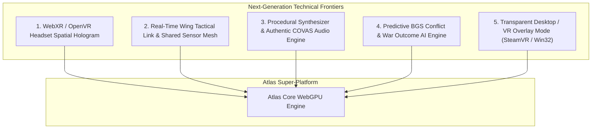

# Atlas - Advanced Ecosystem Expansions: Next-Generation Innovations
**Document ID:** `ATLAS-SPEC-NEXTGEN-EXPANSIONS-01`  
**Classification:** Advanced Feature Engineering & Next-Gen Innovations  
**Objective:** Detail unaddressed frontiers in the Elite Dangerous community: In-Game Overlay HUD (via Overwolf/Steam/Electron), Multi-Commander Wing/Squadron Radar, Sound Design & Audio Synthesis, VR WebXR Support, and Autonomous BGS Simulation Forecasting.

---

## 1. Executive Summary & Vision

Atlas has covered cartography, route plotting, engineering, shipbuilding, trade routing, and native client bridging. To push the platform beyond existing web tools, five untapped technical frontiers remain:

---

## 2. Definitive Next-Generation Features

### Feature 1: WebXR / OpenVR 3D Spatial Hologram (True VR Cockpit Table)
* **The Problem:** VR pilots in Elite Dangerous (Valve Index, Meta Quest 3, Bigscreen Beyond) cannot easily use web tools without awkward floating 2D desktop windows in Virtual Desktop.
* **Atlas Innovation:**
  * Using the **WebXR Device API**, Atlas renders a true 3D spatial holographic Orrery and Galaxy projection in physical room-scale VR.
  * When seated in a VR cockpit sim-rig, the commander can project the interactive System Map directly onto the co-pilot's empty seat or central cockpit console.
  * Hand tracking and 6DoF motion controllers allow grabbing, rotating, and zooming into star systems with natural gestures.

---

### Feature 2: Real-Time Wing Tactical Link & Shared Sensor Mesh
* **The Problem:** In combat wings or multi-ship exploration expeditions, players cannot see each other's precise sensor data, shield status, or targeted enemies unless targeted individually.
* **Atlas Innovation:**
  * **Peer-to-Peer WebRTC Mesh:** Commanders flying in the same Wing or Squadron establish an encrypted, low-latency WebRTC data channel.
  * **Shared Tactical Map:**
    * Displays all wingmate positions, velocities, shield percentages, and heat levels in real time.
    * Highlights which enemy ship each wingmate is currently targeting (*Focus Fire Coordinator*).
    * Synchronized jump countdown: Displays wingmate FSD charge progress bars so squadrons jump and arrive simultaneously.

---

### Feature 3: Web Audio API Procedural Sound Engine & Authentic Radio Filters
* **The Problem:** Modern web tools are dead-silent, sterile spreadsheets that break cockpit immersion.
* **Atlas Innovation:**
  * Built using the **Web Audio API** with zero external audio assets (100% procedural synthesis):
    * **Cobra Engine UI Audio:** Synthesizes the authentic mechanical thuds, orange HUD confirmation beeps, and frequency hums when hovering or clicking stars.
    * **Planetary Atmosphere Acoustics:** Synthesizes low-frequency wind howls and ambient rumble based on atmospheric density ($0.01 - 100\text{ atm}$) and composition (Ammonia, Methane, Water).
    * **Radio Chirp Comms:** Spoken text-to-speech warnings pass through a bandpass filter ($300\text{ Hz} - 3.4\text{ kHz}$) with subtle white noise and distortion to replicate authentic ship-to-ship radio communications.

---

### Feature 4: Autonomous BGS Conflict & War Outcome Predictive Engine
* **The Problem:** Elite BGS trackers show current influence numbers but cannot tell players how many combat bonds or missions are mathematically required to win a war before the daily tick.
* **Atlas Innovation:**
  * **Monte Carlo / Regression Predictive Engine:**
    * Analyzes past daily tick delta trends for the system's population.
    * Calculates the exact **Influence Threshold Formula**:
      $$\Delta \text{Influence} = \frac{\text{Transaction Value}}{\text{System Population Factor}} \times \text{State Multiplier}$$
    * Recommends exact turn-in quotas: *"Squadron needs 4.2M CR in combat bonds before 14:00 UTC to secure Day 3 victory."*

---

### Feature 5: Native In-Game Transparent Overlay (SteamVR & Transparent Win32 Window)
* **The Problem:** Alt-tabbing or looking away at a secondary monitor breaks flight focus during dogfights or high-speed canyon runs.
* **Atlas Innovation:**
  * **Transparent Glass Overlay:** An ultra-lightweight Electron or Tauri wrapper that renders Atlas with a transparent background (`WS_EX_LAYERED | WS_EX_TRANSPARENT`), clicking through directly to Elite Dangerous.
  * **OpenVR / SteamVR Dashboard Overlay:** Projects Atlas as a pinned spatial floating display inside SteamVR, repositionable anywhere in the 3D cockpit.

---

### Feature 6: Odyssey Surface Settlement Stealth Infiltration Planner
* **The Problem:** Infiltrating settlements for covert missions (sabotaging power regulators, stealing settlement data) often results in accidental alarms or failed missions.
* **Atlas Innovation:**
  * **Interactive Building Floorplans:** 3D architectural floorplans for all settlement types (Agricultural, Extraction, Industrial, Military, Tourism).
  * **Terminal & Alarm Panel Locator:** Highlights alarm authorization panels, atmospheric consoles, and security terminal locations.
  * **Guard Patrol Route Simulation:** Visualizes standard AI patrol loops, camera sweeps, and rooftop sniper sightlines.

---

### Feature 7: Thargoid War Titan Decapitation Countdown & Spire Optimizer
* **The Problem:** Coordinating multi-squadron assaults on Titans and Spires requires disjointed Discord spreadsheets and external websites (DCoH).
* **Atlas Innovation:**
  * **Live Titan Thermal Core Vent Timer:** Synchronized timer tracking Titan damage phases, vent opening intervals, and toroid pulse waves.
  * **Spire Sabotage Yield Counter:** Tracks orthopedic tissue and spire pod extraction quotas across active operations.

---

## 3. Master Feature Implementation Matrix

| Next-Gen Feature | Technology Stack | Primary Value |
| :--- | :--- | :--- |
| **WebXR Cockpit Table** | WebXR API, Three.js / WebGPU | True room-scale 3D hologram in VR cockpits. |
| **Wing Tactical Sensor Mesh**| WebRTC DataChannels | Real-time shared targeting and shield vitals for combat wings. |
| **Procedural Audio Engine** | Web Audio API (Synthesizers) | Immersive Cobra UI audio and atmospheric acoustics without loading MP3s. |
| **BGS War Quota Forecaster**| Statistical regression solver | Exact mission/bond quotas needed to flip system control. |
| **Transparent Cockpit Overlay**| Win32 Layered Windows / OpenVR | Click-through HUD overlay over the live game window. |
| **Odyssey Settlement Stealth Planner**| 3D SVG / WebGPU mesh | Floorplans, camera sweeps, and alarm console layouts. |
