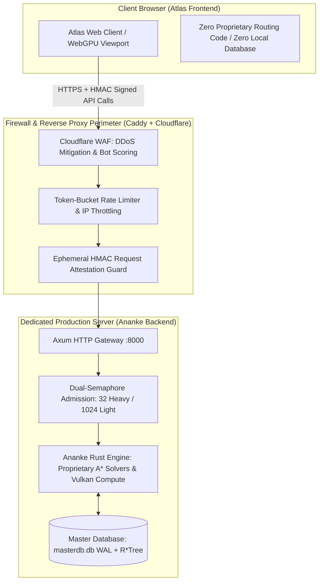

# Atlas - Ananke Security, Server Protection & Anti-Scraping Architecture
**Document ID:** `ATLAS-SEC-ANANKE-01`  
**Classification:** Server Hardening, API Defense & Intellectual Property Protection  
**Target:** Ananke Dedicated Rust Backend Service (`https://ananke.projectgaltea.org` / Port `8000`)  
**Deployment Model:** Externally Hosted Server-Side Microservice (Zero proprietary code in browser)

---

## 1. Architectural Security Advantage: Server-Side Isolation

Because **Ananke remains strictly an externally hosted server service**, our custom routing algorithms, Vulkan compute pipelines, and proprietary mathematical models are **100% physically isolated from the user's browser**:



* **Zero Client Reverse-Engineering Risk:** No WebAssembly decompilation, no `.wat` file recovery, no client-side memory dump threats. All proprietary A* pathfinding and data models execute exclusively on the host server.

---

## 2. Server-Side Binary Protection & Reverse-Engineering Defense

On the host server where the Ananke binary runs:

### 2.1 Compiler Hardening & Symbol Stripping
The production binary (`ananke`) is compiled with maximum optimization and aggressive stripping:
```toml
# In Cargo.toml
[profile.release]
opt-level = 3
lto = "fat"                 # Inter-procedural link-time optimization
codegen-units = 1           # Merged translation units destroying function boundaries
panic = "abort"             # Drops unwind tables and stack trace strings
strip = "symbols"           # Strips all debuginfo, function names, and variable symbols
```

### 2.2 Host Isolation & Least-Privilege Execution
* Ananke runs under an unprivileged systemd user account (`galtea:galtea`) with:
  * `ProtectSystem=strict`: Root filesystem mounted read-only.
  * `ProtectHome=true`: Prevents access to user home directories.
  * `PrivateTmp=true`: Isolated `/tmp` namespace.
  * `NoNewPrivileges=true`: Disallows privilege escalation.

---

## 3. API Protection, Anti-Scraping & Request Attestation

Because the client communicates with Ananke via REST APIs, security focuses on protecting the server from unauthorized scraping, automated bot abuse, and resource exhaustion:

### 3.1 Ephemeral HMAC Request Attestation
To prevent third-party tools from unauthorized scraping of Ananke's endpoints:
* Every request from the Atlas web client includes a signed header:
  $$\text{X-Atlas-Signature} = \text{HMAC-SHA256}(\text{SessionSecret}, \text{Timestamp} + \text{EndpointPath} + \text{Nonce})$$
* The signature expires after **30 seconds**.
* Unsigned requests or stale timestamps are rejected with HTTP 403 Forbidden.

### 3.2 Dual-Semaphore Admission & Resource Protection
Ananke enforces strict concurrency controls to prevent denial-of-service (DoS) and heavy solver exhaustion:
* **Light Endpoints (`/api/search`, `/api/system`, `/api/cube-search`):**
  * Handled via token bucket rate-limiting (e.g., 60 requests/min per IP).
  * Max 1,024 concurrent lightweight permits in Tokio async queue.
* **Heavy Endpoints (`/api/carrier-route`, `/api/neutron-route`):**
  * Strictly bounded by Tokio async semaphores: **maximum 32 concurrent solver slots**.
  * Queued with a 60-second wait budget before graceful 503 load shedding.

### 3.3 Reverse Proxy Defense (Caddy & Cloudflare)
* Upstream Cloudflare WAF filters automated headless scrapers, bad bots, and volumetric traffic spikes.
* Caddy reverse proxy terminates TLS and enforces strict CORS policies allowing only the official Atlas web domain.
