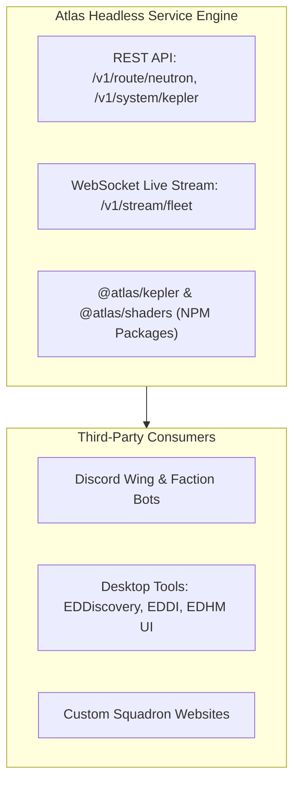

# Atlas - Community Ecosystem, API Infrastructure & Modding Support
**Target:** The Developer, Community Contributor & Third-Party Tool Pipeline  
**Scope:** Public REST APIs, WebSocket streaming bus, open plugin architecture, and community localization.

---

## 1. Public Atlas Open Developer API (Headless Engine)

Just as EDCD/EDDN and Spansh power the community, Atlas exposes its GPU-accelerated calculations, Keplerian orbital algorithms, and route plotting as an **open public service**:

### 1.1 Developer Endpoints:
* `POST /v1/route/neutron`: Accepts `{ source, destination, jumpRange, efficiency }` and returns sub-millisecond 3D waypoints with fuel stops.
* `GET /v1/system/:systemAddress/kepler?timestamp=...`: Returns exact 3D Cartesian vectors for all planets and stations at any past, present, or future timestamp.
* `POST /v1/exobiology/payout`: Computes estimated Vista Genomics payouts for a list of scanned organic species.

---

## 2. Micro-Plugin Architecture for Community Modding

To allow third-party developers to extend Atlas without modifying core code:
* **Atlas Sandboxed Plugin SDK (`AtlasPlugin`):**
  * Custom HUD theme loaders (e.g. EDHM-style blue, cyan, crimson, or purple themes).
  * Custom overlay layers (e.g. Squadron-specific territorial heatmaps, BGS war markers).
  * Custom audio packs (replacing synthetic COVAS with custom sound recordings).

---

## 3. High-Resolution 8K/16K Screenshot & Poster Exporter

Commanders often want high-resolution cartographic maps for desktop wallpapers, prints, or squadron recruitment posters:
* **Offscreen Canvas Super-Sampling:**
  * Leverages WebGPU's offscreen rendering to render the current 3D Galaxy Map, System Map, or Orrery at **$8K$ ($7680 \times 4320$)** or **$16K$ resolution** with anti-aliasing and cinematic bloom.
* **SVG Vector Map Exporter:**
  * Exports the current 2D System Map hierarchy directly as a lossless `.svg` or `.pdf` file with customized commander flight logs, perfect for archival printing.

---

## 4. Community Crowdsourced Validation & Data Submission

* **EDDN Event Forwarding:**
  * When a player runs Atlas with local journal access, any unlogged systems, organic scans, or market prices are automatically sanitized and broadcast to the community EDDN network (`tcp://eddn.edcd.io:9500`).
* **First Discovery Attribution:**
  * Highlights "Discovered by CMDR [Name]" and "First Footfall by CMDR [Name]" directly in the System Map dossier, immortalizing player achievements.
