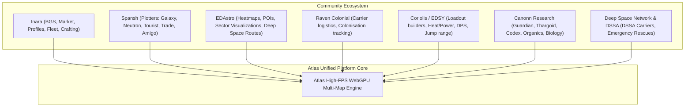

# Atlas - Comprehensive Feature Catalog: Gap Analysis & Missing Community Tools
**Document ID:** `ATLAS-SPEC-COMMUNITY-FEATURES-01`  
**Classification:** Comprehensive Feature Specification & Ecosystem Integration  
**Scope:** Deep gap analysis of all major Elite Dangerous community tools (Inara, Spansh, EDAstro, Coriolis, EDSY, Raven Colonial, EDMC, Canonn, EDSM, DCI) and defining unaddressed high-value features for Atlas.

---

## 1. Elite Dangerous Community Tool Matrix & Gap Analysis

To make Atlas the definitive cartography and navigation platform, we evaluated the capabilities of the primary community sites and identified what has not yet been covered:

---

## 2. Unaddressed Features to Add to Atlas

Below is the definitive catalog of features from the Elite Dangerous ecosystem that were not previously specified in Atlas, organized by domain:

### Category A: Advanced Navigation & Complex Route Plotting (Spansh & Deep Space Extensions)
1. **Multi-Stop Route Optimizer (Traveling Salesperson / "Trade Amigo" / VIP Tourism Planner):**
   * *What it does:* Given an arbitrary list of up to 50 systems or passenger tourist beacons, calculates the mathematically optimal visit order minimizing total light-years and fuel hops.
   * *Atlas Implementation:* Fast 2-opt heuristic solver running inside a dedicated Web Worker, with an interactive route itinerary list and 3D visual circuit line.
2. **Road to Riches (R2R) Express Exploration Route Generator:**
   * *What it does:* Plots a high-profit exploration path between Point A and Point B visiting only unmapped or high-value Terraformable Water Worlds, Earth-Like Worlds (ELWs), and Ammonia Worlds.
   * *Atlas Implementation:* Slider for minimum body value (e.g. $>1\text{M CR}$), maximum arrival distance from main star (e.g. $<1500\text{ LS}$), and automatic estimated scan payout calculator.
3. **Fleet Carrier Fuel Logistics & Tritium Route Depot Planner:**
   * *What it does:* Computes carrier jumps considering depot capacity, cargo hold mass, and identifies the cheapest/nearest Tritium purchase depots along the long-range route.
4. **Exact Supercruise Orbital Assist & Gravity Brake Vector Estimator:**
   * *What it does:* Visualizes optimal supercruise deceleration arcs (the "6-second rule") and calculates gravity braking curves when approaching high-mass gas giants or binary companion stars.

---

### Category B: Fleet, Shipyard & Ship Loadout Integration (Coriolis & EDSY Parity)
5. **Interactive Ship Loadout Importer & In-Map Range Adjuster:**
   * *What it does:* Imports ship builds directly via Coriolis/EDSY JSON or Frontier CAPI journal `Loadout.json`.
   * *Atlas Implementation:* Dynamically reads current fuel, cargo mass, and engineered FSD jump range. Changing cargo slider instantly updates the **3D Jump Bubble Sphere** rendered around the player's ship in the 3D Galaxy View.
6. **Outfitting & Shipyard Stock Locator:**
   * *What it does:* Search for specific module ratings (e.g., `Class 6A Fuel Scoop`, `5A FSD (V1 Pre-Engineered)`, `Thermal Vent Beam Lasers`) and specific ship hulls (Imperial Cutter, Federal Corvette, Python Mk II).
   * *Atlas Implementation:* Highlights stations on the System Map with appropriate landing pad sizes (Small, Medium, Large) and real-time stock freshness timestamps.

---

### Category C: Background Simulation (BGS), Minor Factions & Powerplay 2.0 (Inara Parity)
7. **Minor Faction Influence Graphs & System State Tracker:**
   * *What it does:* Tracks faction influence percentages over time ($0\% - 100\%$) across multiple systems.
   * *Atlas Implementation:* Interactive line charts showing Boom, War, Civil War, Election, Bust, and Expansion states. Displays conflict zones (CZs) and election installations directly on the System Map.
8. **Powerplay 2.0 Stronghold & Territory Frontline Visualizer:**
   * *What it does:* Visualizes Powerplay 2.0 territory spheres, exploited systems, stronghold systems, and acquisition targets with faction-colored voronoi/influence boundaries.
   * *Atlas Implementation:* 3D colored territory volumetric clouds around leaders (Felicia Winters, Zachary Hudson, Aisling Duval, Arissa Lavigny-Duval, Denton Patreus, Zemina Torval, Edmund Mahon, Li Yong-Rui, Pranav Antal, Archon Delaine, Yuri Grom).
9. **Faction Expansion Target Predictor:**
   * *What it does:* When a faction reaches $>75\%$ influence, calculates the nearest eligible target system within $20\text{ LY}$ with $<7$ factions to predict where the expansion will trigger.

---

### Category D: Engineering, Materials & Blueprints (Inara / EDEngineer Parity)
10. **Engineering Blueprint Crafting Wishlist & Material Deficit Calculator:**
    * *What it does:* Select desired blueprints (e.g., `Grade 5 Increased FSD Range + Mass Manager`, `Grade 5 Dirty Drives + Drag Drives`).
    * *Atlas Implementation:* Calculates required Raw, Encoded, and Manufactured materials, cross-references with current inventory (via CAPI/Journal), and plots the optimal route to material traders or farming sites (Jameson Crash Site, Dav's Hope, Crystalline Shards).
11. **Nearest Crystalline Shard Biological Sites (Grade 4 Raw Material Farming):**
    * *What it does:* Direct locator for selenium, polonium, tellurium, technetium, ruthenium, antimony, and yttrium farming planets with DSS coordinate guidance.

---

### Category E: Deep Space Exploration, DSSA & Emergency Rescue (EDAstro & DCI Parity)
12. **DSSA (Deep Space Support Array) Permanent Carrier Network Overlay:**
    * *What it does:* Overlays all ~150 official DSSA Fleet Carriers permanently stationed across all 42 galactic regions.
    * *Atlas Implementation:* Displays carrier status, available services (Repair, Refuel, Armory, Universal Cartographics, Vista Genomics), operational frequency, and current Discord/admin contact.
13. **Fuel Rats & Hull Seals Emergency Distress Telemetry Beacon:**
    * *What it does:* One-click emergency tool for stranded explorers with empty fuel tanks or cracked cockpits.
    * *Atlas Implementation:* Generates emergency coordinate string, system name, distance from Sol, nearest stars with scoopable KGBFOAM classes, and direct link to dispatch on `fuelrats.com`.
14. **Historic Galactic Expeditions & Exploration Highway Traces (EDAstro Parity):**
    * *What it does:* Historical route paths of famous expeditions (Distant Worlds 1 & 2, Beagle Point 3301, Sagittarius-Carina Mission).
    * *Atlas Implementation:* Toggleable glowing historical path ribbons in the 3D galaxy with waypoint markers and expedition lore plaques.

---

### Category F: Canonn Science, Guardian/Thargoid Sites & Planetary Coordinates (Canonn Parity)
15. **Planetary Surface Coordinate HUD & Bearing Compass (Surface Navigation):**
    * *What it does:* Eliminates the struggle of manual latitude/longitude flight.
    * *Atlas Implementation:* Enter target coordinates (e.g. Dav's Hope: `Lat: 44.8362, Lon: -31.3874`). Computes real-time **Heading Bearing ($0^\circ - 360^\circ$)**, distance remaining, and glide entry slope from current ship position.
16. **Interactive Guardian Ruins & Structure Obelisk Puzzle Solver:**
    * *What it does:* Interactive blueprint map for all Guardian Sites (Module, Weapon, and Vessel blueprints).
    * *Atlas Implementation:* Shows exact ancient relic, urn, totem, tablet, caryatid, and orb spawn locations. Visualizes energy pylon activation order and terminal scan sequences.
17. **Thargoid Surface Sites & Device Activation Guide:**
    * *What it does:* Layout of all 200+ unknown surface structures (Thargoid Scavengers, Unknown Devices). Shows requirement for Thargoid Probe + Sensor + Link to activate the central star map hologram.

---

### Category G: Fleet Carrier Operations & Colonisation Logistics (Raven Colonial Parity)
18. **Fleet Carrier Cargo & Market Commodity Ledger:**
    * *What it does:* Full inventory management of personal or squadron Fleet Carriers.
    * *Atlas Implementation:* Tracks buy/sell orders, available cargo space ($0 - 25,000\text{ T}$), weekly upkeep costs, fuel in tank vs cargo hold, and projected profit from public trade tariffs.
19. **Community Goal (CG) & War Frontline Contested System Tracker:**
    * *What it does:* Live feed of active Frontier Community Goals with delivery tiers, percentage leaderboards (Top 100%, 75%, 50%, 25%, 10%), and remaining time countdowns.

---

## 3. High-Value Differentiating Features Exclusive to Atlas

These are innovative features that **no existing community tool currently possesses**, made possible by Atlas's WebGPU architecture and in-service database:

| Feature Name | Unique Value Proposition |
| :--- | :--- |
| **1. 3D Keplerian Eclipse & Transit Simulator** | True-to-scale physics simulation allowing pilots to find systems where a planet is currently transiting its star or where total solar eclipses are occurring at any given timestamp. |
| **2. Multi-Star Skybox Projection Renderer** | From any selected planet's surface, renders a simulated 360-degree skybox showing how neighboring stars, galactic dust clouds, and the galactic core appear from that exact spot. |
| **3. Synchronized Dual-Screen Cockpit Mode** | Split-screen or multi-monitor support: Screen 1 shows 3D Galaxy navigation, while Screen 2 (or a tablet on the desk) stays locked to the current system's live Orrery and planetary landing coordinates. |
| **4. Instant 1-Key In-Game Clipboard Injector** | Deep Web-to-Game synchronization: Selecting any search result, waypoint, or market immediately pushes the system/station to clipboard with zero clicks. |
| **5. Procedural Uncharted Starbox Predictor** | For unvisited systems, uses Frontier's exact mass-code algorithm (Boxel octrees) to project how many stars exist in unvisited sectors before anyone has traveled there. |

---

## 4. Master Feature Implementation Status & Placement

| New Feature | Origin Inspiration | Planned Location in Atlas Codebase |
| :--- | :--- | :--- |
| **Multi-Stop Route Optimizer** | Spansh "Tour" / Trade Amigo | `src/lib/solvers/TourOptimizerWorker.ts` |
| **Road to Riches (R2R)** | Spansh R2R / EDAstro | `src/lib/components/RoadToRichesDrawer.svelte` |
| **Ship Loadout & Jump Range Adjuster**| Coriolis / EDSY | `src/lib/components/ShipLoadoutModal.svelte` |
| **BGS Influence & State Tracker** | Inara BGS | `src/lib/components/BgsFactionDossier.svelte` |
| **Powerplay 2.0 Spheres** | Inara / In-Game Map | `src/lib/engine/shaders/PowerplayVolumeShader.wgsl` |
| **Engineering Wishlist & Material Grids**| Inara Crafting / EDEngineer | `src/lib/components/EngineeringCalculator.svelte`|
| **DSSA Deep Space Network Overlay** | EDAstro / DCI | `src/lib/layers/DssaCarriersLayer.svelte` |
| **Fuel Rats Emergency Distress Beacon** | Fuel Rats / Hull Seals | `src/lib/components/EmergencyBeaconModal.svelte` |
| **Planetary Surface Bearing Compass** | Canonn / EDDiscovery | `src/lib/components/SurfaceCompassHUD.svelte` |
| **Guardian Ruins Puzzle Map** | Canonn Science | `src/lib/components/GuardianPuzzleViewer.svelte` |
| **Carrier Fleet Logistics & Upkeep** | Raven Colonial / Inara | `src/lib/components/CarrierLogisticsPanel.svelte` |
| **3D Solar Eclipse & Transit Predictor**| *Atlas Exclusive* | `src/lib/solvers/EclipsePredictor.ts` |
