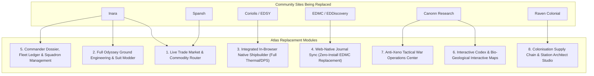

# Atlas - Complete Community Replacement Blueprint: The Unified Elite Dangerous Super-Platform
**Document ID:** `ATLAS-SPEC-SUPER-PLATFORM-01`  
**Classification:** Strategic Feature Blueprint & Community Tool Replacement Architecture  
**Objective:** Detail the specific features required for Atlas to completely replace Inara, Spansh, Coriolis/EDSY, EDMC, Canonn, EDSM, Raven Colonial, and DCI within a single unified high-performance application.

---

## 1. Executive Strategy: Why Players Switch

Players currently use 5 to 7 different tabs while flying:
* **Tab 1:** Inara (BGS, trade prices, materials, engineer unlocks)
* **Tab 2:** Spansh (Neutron plotting, fleet carrier jumps, R2R)
* **Tab 3:** Coriolis or EDSY (Ship builds, thermal/power profiles)
* **Tab 4:** EDAstro / Canonn (Visual sector heatmaps, Guardian/Bio maps)
* **Tab 5:** EDMC / EDDiscovery (Desktop app to push journal data)
* **Tab 6:** Raven Colonial / DCI (Fleet Carrier market management)

Atlas can **replace them all** because none of those sites have:
1. A **hardware-accelerated 3D WebGPU game engine** that visualizes data directly in spatial 3D.
2. Direct **Frontier CAPI player linkage** that automatically knows your commander's exact location, ship, inventory, credits, and ranks without third-party desktop apps.
3. Sub-second response times backed by the dedicated **Ananke** engine and in-service `masterdb.db`.

---

## 2. Definitive Feature Additions to Replace Each Community Site

---

### Module 1: Live Trade Engine & Commodity Router (Replaces Inara Markets & Spansh Trade)
* **Single-Hop Best Trade Finder:** Computes maximum profit per ton for current ship cargo capacity, distance, and landing pad size.
* **Multi-Hop Loop Route Planner:** 2-to-6 stop circular trade routes maximizing Cr/hour while avoiding empty return hauls.
* **Supply/Demand Decay & Price Freshness Gauges:** Shows price age (<5 min, 1h, 1d) with automatic warnings if stock is below 10% of demand to prevent "ghost routes".
* **Black Market Smuggling Finder:** High-profit contraband locator (Narcotics, Imperial Slaves, Weapons) paired with security state filters (Anarchy systems).

---

### Module 2: Full Odyssey & Horizons Engineering Engine (Replaces Inara Crafting)
* **Complete Engineer Unlock Tree & Tracker:** Visual dependency flowchart of all 25 ship engineers + 9 Odyssey suit engineers, tracking unlock requirements, referral paths, and current invitation status.
* **Odyssey On-Foot Suit & Weapon Mod Simulator:**
  * Mod out Artemis, Dominator, and Maverick suits (Night Vision, Extra Backpack, Sprint Duration, Quieter Footsteps).
  * Weapon modding: Audio Masking, Stowed Reloading, Headshot Damage, Scope Zoom.
* **Material Auto-Shopping List:** Check off desired ship/suit mods; Atlas calculates the net material deficit, plots trade routes to the nearest Raw/Manufactured/Encoded material traders, and generates optimal farming routes (Dav's Hope, Jameson Crash Site, Crystalline Shards).

---

### Module 3: Full In-Browser Shipbuilder (Replaces Coriolis & EDSY)
* **100% Native Loadout Engineering Suite:** Complete shipbuilder inside Atlas—no external tabs.
* **Thermals, Power & Convergence Simulator:**
  * Exact thermal dissipation curves (Thermal Vent cooling vs. Overcharged Plasma Accelerator heat generation).
  * Power priority management (deploy/retract states, power plant malfunction 40% survival checks).
  * Weapon hardpoint spatial convergence simulator showing gimbal/fixed tracking geometry.
* **1-Click Live Ingest & Export:** Import/Export via EDSY/Coriolis JSON, Frontier CAPI live loadout, or shareable short URL.

---

### Module 4: Web-Native Journal Sync (Replaces EDMC & EDDiscovery)
* **Zero Desktop App Requirement:** Using the modern **HTML5 File System Access API (`showDirectoryPicker`)**, players grant Atlas direct read access to their local `Saved Games/Frontier Developments/Elite Dangerous/` folder in the browser.
* **Real-Time Live Cockpit Telemetry:**
  * `Status.json` watch: Displays live fuel level, pips distribution, cargo count, landing gear, supercruise state, and planet coordinates directly in the Atlas HUD overlay.
  * `Journal.*.log` watch: Auto-detects `FSDJump`, `Scan`, `Location`, `MarketBuy`, `Touchdown`, `Docked`, and broadcasts to EDDN automatically (user toggleable).

---

### Module 5: Commander Dossier, Squadron Hub & Fleet Ledger (Replaces Inara Profiles)
* **Official CMDR Dossier Card:** Displays verified Frontier ranks (Combat, Trade, Exploration, CQC, Soldier, Exobiologist) with real-time progression percentages.
* **Full Fleet Ledger:** Lists every ship owned across all stations with current location, transfer fee, transfer time, and full installed module specs.
* **Squadron Operations Room:**
  * Squadron member roster with last-seen systems.
  * Shared squadron bookmarks and tactical mission markers on the 3D Galaxy Map.
  * Squadron BGS priority targets (e.g. "Support Faction X in System Y during Civil War").

---

### Module 6: Canonn Science, Codex & Archeology Viewer (Replaces Canonn Research)
* **Bio-Geological Interactive Planetary Surface Maps:** Visual breakdown of all biological variants (Fonticula, Stratum, Tussock, Clypeus) with color-coded terrain preference overlays (Rocky, High Metal Content, Ice).
* **Guardian Site Solver & Obelisk Matrix:** Interactive 2D/3D map of all Guardian Ruins showing exact spawn points for Blueprints, Urns, Tablets, Totems, and Pylon activation orders.
* **Generation Ships, Megaships & Abandoned Settlements:** Audio log archive featuring lore transcripts and audio playback for all 15+ Generation Ships and lore POIs.

---

### Module 7: Anti-Xeno War Room & Titan Tactical Center (Replaces DCoH / AXI Tools)
* **Titan Maelstrom Real-Time Status:** Tracks the health and meltdown countdowns of active and vanquished Titans (Taranis, Leigong, Oya, Hadad, Thor, Raijin, Indra, Cocijo).
* **Spire Site Sabotage Operations:** Pinpoints active Thargoid Spire sites, contamination percentages, and counter-spire mission boards.
* **Anti-Xeno Ship Loadout Meta Guides:** Pre-configured AX ship builds (Cold-orbiting Chieftain, Krait Mk II Gauss, Titan-bomber Python Mk II) with one-click import into the Atlas shipbuilder.

---

### Module 8: Colonisation Supply Chain & Station Builder (Replaces Raven Colonial)
* **Virgin System Colonisation Viability Evaluator:** Scans virgin systems for planetary resources, orbital slot capacity, and construction material supply chains.
* **Station Construction Material Ledger:** Tracks required vs delivered building supplies (Titanium, Steel, Superconductors, Computer Components) with automatic routing to the nearest bulk supply stations.
* **Fleet Carrier Squadron Logistics:** Carrier depot capacity sharing, Tritium jump cost pooling, and automated route scheduling for construction fleets.

---

## 3. High-Value UX Features No Community Site Has

| Innovative Feature | Competitive Advantage Over Inara / Spansh |
| :--- | :--- |
| **1. Dual-Monitor Cockpit Mode** | Main monitor shows 3D Galaxy Map; second monitor/tablet shows active Orrery + Surface Landing Compass locked to your active ship. |
| **2. Instant 1-Key Clipboard Sync** | Every search result, route hop, or station has a 1-key keyboard shortcut that copies to clipboard for direct `Ctrl+V` inside Elite Dangerous. |
| **3. WebGPU 3D Space Overlay** | Route lines, carrier hops, Powerplay bubbles, and BGS faction zones are rendered as glowing physical geometry in space, not flat tables. |
| **4. Zero-Install Web Journal Sync** | Replaces external Python desktop apps (EDMC) with in-browser local file system streaming. |
| **5. CAPI Authenticated Identity** | Zero manual registration or fake account spoofing—identities are cryptographically guaranteed by Frontier OAuth2. |

---

## 4. Implementation Priority Matrix

| Phase | Module | Primary Benefit |
| :---: | :--- | :--- |
| **P1** | **Web-Native Journal Sync (HTML5 File Access)** | Replaces EDMC; unlocks instant live telemetry without software installs. |
| **P2** | **Live Trade Market & Commodity Router** | Replaces Inara Trade & Spansh Loop Trade. |
| **P3** | **Integrated In-Browser Shipbuilder** | Replaces Coriolis & EDSY with native WebGPU visual ship models. |
| **P4** | **Odyssey & Horizons Engineering Assistant** | Replaces Inara Crafting with shopping list deficit routing. |
| **P5** | **Squadron Hub & Fleet Ledger** | Replaces Inara Squadrons & Fleet pages. |
| **P6** | **Canonn Science & Bio-Geological HUD** | Replaces Canonn Research with 3D planetary landing guidance. |
| **P7** | **Colonisation & Carrier Logistics** | Replaces Raven Colonial for new Frontier colonisation gameplay. |
