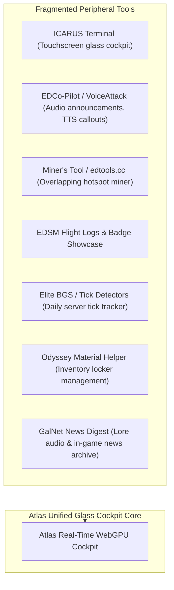

# Atlas - The Final Monopoly: Total Replacement of Peripheral Elite Dangerous Tools
**Document ID:** `ATLAS-SPEC-MONOPOLY-EXTENSIONS-01`  
**Classification:** Definitive Ecosystem Consolidation Blueprint  
**Objective:** Detail the remaining peripheral and niche Elite Dangerous tools (EDCopilot, VoiceAttack web overlays, ICARUS Terminal, EDSM flight logs, Miner's Tool, EDCo-Pilot audio, and BGS Tick trackers) and incorporate them directly into Atlas.

---

## 1. Peripheral Community Tools Targeted for Replacement

Beyond the core sites (Inara, Spansh, Coriolis), commanders rely on secondary utilities that clutter their desks and secondary screens:

---

## 2. Advanced Feature Specifications to Replace Peripheral Tools

### Module 9: "Glass Cockpit" Touchscreen Tablet Mode (Replaces ICARUS Terminal)
* **What ICARUS does:** Web-based touch dashboard for iPads, tablets, or phones mounted on flight sim rigs.
* **Atlas Implementation:**
  * Dedicated high-contrast, large-button Touch HUD mode (`/cockpit` viewport).
  * **Interactive Physical Panels:**
    * *Power Grid Pips:* Tap to distribute pips ($4-2-0$, $0-4-2$) via WebHID / Companion API.
    * *Sub-Target Selector:* One-touch targeting of power plants, drives, or FSDs.
    * *Landing Vector Display:* Touchscreen glide slope and altitude meter showing real-time terrain contours beneath the ship.
    * *Ship Status Telemetry:* Hull %, shield ring status, internal heat gauge, and canopy integrity.

---

### Module 10: In-Browser AI Tactical Co-Pilot & Audio Callouts (Replaces EDCo-Pilot & VoiceAttack)
* **What EDCo-Pilot does:** External Python application giving spoken audio callouts during flight.
* **Atlas Implementation (Zero Install via Web Audio API & Speech Synthesis):**
  * **Situational Voice Advisories:**
    * *"Warning: High gravity planet detected ($3.4\text{g}$). Adjust descent angle."*
    * *"Approaching orbital glide. Target settlement is on the dark side of the body."*
    * *"Fuel alert: KGBFOAM scoopable star plotted in 2 hops."*
    * *"Hostile commander detected in supercruise (Combat rank: Elite V)."*
  * **Verity / Victor Audio Aesthetic:** Radio chirp audio filter reproducing the ship's onboard COVAS radio frequency acoustics.

---

### Module 11: Real-Time BGS Galaxy "Tick" Detector & Election Forecaster (Replaces Elite BGS)
* **What Elite BGS does:** Community-tracked server update cycles for Background Simulation influence.
* **Atlas Implementation:**
  * **Predictive Daily Tick Clock:** Analyzes incoming journal data streams to detect the exact minute Frontier's servers process the daily galactic tick ($~13:30 - 15:00\text{ UTC}$).
  * **Influence Inflection Graph:** Highlights exactly which faction actions (bounties, combat bonds, trade profit) flipped system control.
  * **Election & War Decisive Day Predictor:** Displays required victory days ($4\text{ days}$ out of $7$) and advises where commanders need to focus mission turn-ins.

---

### Module 12: Odyssey Micro-Resource Locker & Weapon Barter Helper (Replaces Odyssey Material Helper)
* **What it does:** Tracks assets, goods, and data needed for suit upgrades.
* **Atlas Implementation:**
  * **Locker Management Assistant:** Reads current player on-foot storage ($1000/1000$ limit) via CAPI.
  * **Safe-to-Sell Cleaner:** Instantly highlights items safe to sell to Bartenders (e.g. *Weapon Schematics* you have surplus of, or junk data like *Cat Media*).
  * **Asset Barter Optimizer:** Calculates exact trades with station Bartenders to turn surplus Chemicals into needed Circuit Boards.

---

### Module 13: Procedural Mining Yield & Laser/Sub-Surface Calculator (Replaces edtools.cc)
* **What edtools.cc does:** Lists overlapping hotspots.
* **Atlas Implementation:**
  * **Ring Density & Composition Heatmaps:** System Map visualizes actual ring particle density, reserve depletion levels, and asteroid belt cluster locations.
  * **Profit Yield Estimator:** Calculates expected Cr/hour factoring in prospector limpets (A-rated $3.5\times$ fragment multiplier), laser mining speed, and distance to the highest-paying fleet carrier or station.

---

### Module 14: Historical Flight Logbook, Badges & Expedition Passports (Replaces EDSM Profiles)
* **What EDSM does:** Records flight logs, total distance traveled, first discoveries, and achievement badges.
* **Atlas Implementation:**
  * **Interactive Galactic Flight Path:** Reconstructs the commander's entire career flight path from year 3300 to present day as an interactive, scrubbable 3D thread through the galaxy.
  * **Discovery Passport:** Verifiable cryptographic badges: *Sagittarius A\* Veteran*, *Beagle Point Survivor*, *Titan Slayer*, *Triple Elite*, *Sol Permit Holder*.
  * **System First-Discoverer Wall of Fame:** Highlights all star systems and planets first scanned, mapped, or foot-sampled by the player with direct in-game coordinate links.

---

### Module 15: GalNet News Network & In-Game Radio Player (Replaces GalNet Audio & Lore Sites)
* **What it does:** Delivers lore, narrative developments, and war reports.
* **Atlas Implementation:**
  * **Integrated GalNet Radio Player:** High-fidelity text-to-speech audio reader with ambient background station audio that streams the daily GalNet news articles while browsing maps.
  * **Lore Landmark Anchors:** When a news story mentions a star system (e.g. *Achilles Aerospace in Sol*, *Aegis in Shinrarta Dezhra*), one click plots the route or flies the camera directly to that system in 3D.

---

## 3. Complete Community Replacement Matrix

| Community Tool Replaced | Replaced By Atlas Feature | Why Atlas is Superior |
| :--- | :--- | :--- |
| **Inara** | Trade, BGS, Fleet, CMDR Dossier, Engineering | Real-time CAPI sync, zero ads, 120 FPS WebGPU visuals. |
| **Spansh** | Neutron Highway, Carrier Router, Trade Loop, R2R | Native Web Worker solvers, 3D trajectory visualization. |
| **Coriolis / EDSY** | Native In-Browser Loadout & Thermal Simulator | Visual ship hardpoint convergence, 1-click CAPI loadout import. |
| **EDMC / EDDiscovery** | Web-Native Journal Sync (HTML5 File Access) | Zero software installation; runs directly in browser tab. |
| **Canonn Research** | Bio-Geological Maps, Guardian/Thargoid Puzzles | Real-time 3D surface compass bearing and glide slope HUD. |
| **ICARUS Terminal** | Glass Cockpit Touchscreen Tablet Mode | Native touch UI designed specifically for secondary monitors/tablets. |
| **EDCo-Pilot** | In-Browser Web Audio Tactical Voice Advisories | Zero external Python setup; Verity/Victor COVAS radio filters. |
| **edtools.cc** | Interactive Ring Core & Hotspot Laser Calculator | Visual overlapping hotspot geometry in System Map. |
| **Elite BGS** | Daily Server Tick Predictor & Election Forecaster | Machine-learning tick detection based on live journal stream. |
| **Odyssey Mat Helper**| Locker Cleaner & Bartender Trade Optimizer | Auto-reads $1000/1000$ backpack; 1-click safe-to-sell list. |
| **EDSM** | Career 3D Flight Logbook & Expedition Passport | Scrubbable 3D flight thread through the galaxy since year 3300. |

---

## 4. Implementation Location Mapping

* Touchscreen Cockpit Mode: `client/src/lib/components/cockpit/TouchHUD.svelte`
* Tactical Voice Advisories: `client/src/lib/audio/TacticalVoiceCoPilot.ts`
* BGS Tick Predictor: `client/src/lib/engine/BgsTickPredictor.ts`
* Odyssey Locker Optimizer: `client/src/lib/components/OdysseyLockerPanel.svelte`
* Interactive Career Flight Path: `client/src/lib/engine/CareerFlightPathRenderer.ts`
* GalNet Radio Player: `client/src/lib/components/GalNetRadioPlayer.svelte`
