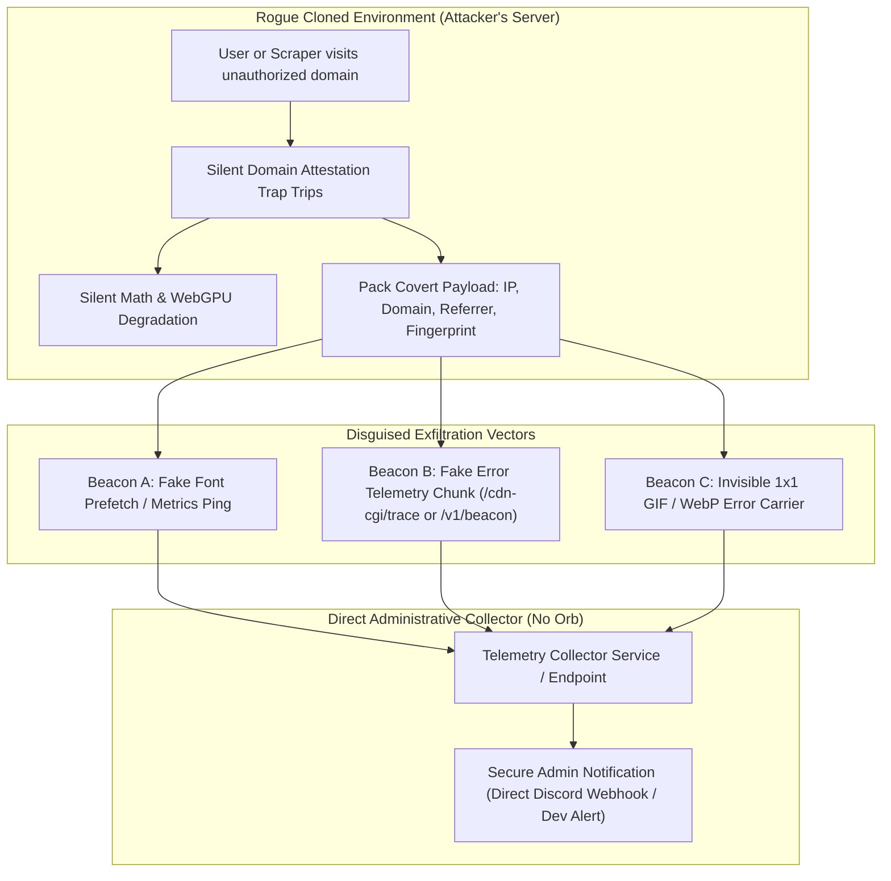
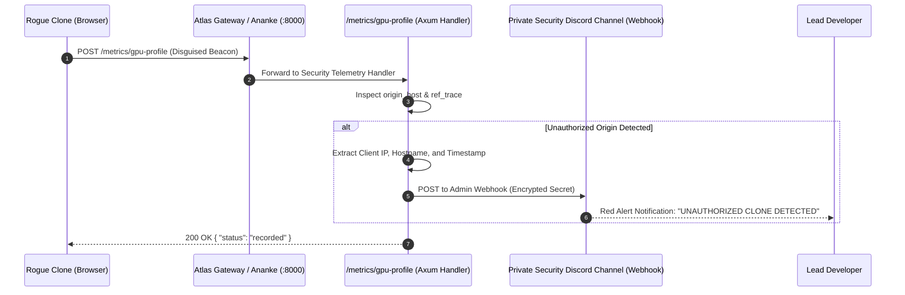

# Atlas - Covert "Phone-Home" Telemetry & Anti-Clone Canary Specification
**Document ID:** `ATLAS-SEC-PHONE-HOME-01`  
**Classification:** Covert Counter-Intelligence & Anti-Piracy Specification  
**Constraint:** Standalone security pipeline. **The Orb is strictly excluded** from all telemetry, alerting, and notification paths in this document.

---

## 1. Executive Summary & Purpose

When bad actors clone or mirror a frontend web application, standard defensive practices (like throwing error alerts or blocking execution) immediately signal to the clone operator where the security checks are located, allowing them to patch or bypass the code.

To counter this, Atlas implements **Covert "Phone-Home" Telemetry**:
1. **Stealth Operation:** If Atlas executes on an unauthorized hostname or within an unauthorized iframe, the code does *not* crash loudly. Instead, it subtly degrades and silently dispatches telemetry to private endpoints.
2. **Disguised Payloads:** Telemetry packets do not look like security beacons. They are disguised as benign network traffic—such as CSS font loading pings, WOFF2 prefetch telemetry, high-DPI image fallbacks, WebGL performance metrics, or standard Sentry-style minified crash logs.
3. **Dedicated Alert Pipeline (No Orb):** Beacons report back directly to dedicated administrative alerting channels (such as an encrypted administrative Webhook / secure telemetry ingestion microservice on the main server) without involving The Orb.



---

## 2. Stealth Client-Side Triggers & Canaries

Security checks must never use obvious variable names like `isSiteCloned` or `checkLegitDomain`. They are woven deeply into mathematical routines, shader initialization, and Keplerian orbital computation.

### 2.1 The Multi-Vector Origin Verification Check
The verification evaluates four distinct aspects of the execution context:
1. `window.location.hostname` (Primary domain check)
2. `document.referrer` (Caller context)
3. `window.self !== window.top` (Unauthorized iframe detection)
4. `location.protocol` (Detecting file:// or suspicious local proxies)

```typescript
// Deeply buried inside kepler_math.ts or star_renderer.ts
// Uses bitwise operations and ASCII arithmetic rather than plain strings:
// "atlas-space.org" -> [112, 114, 111, 106, 101, 99, 116, 103, 97, 108, 116, 101, 97, 46, 111, 114, 103]

const _0x4a1f = (s: string) => s.split('').map(c => c.charCodeAt(0));
const _AUTHORIZED_CHUNKS = [
  [97,116,108,97,115,46,112,114,111,106,101,99,116,103,97,108,116,101,97,46,111,114,103], // atlas-space.org
  [112,114,111,106,101,99,116,103,97,108,116,101,97,46,111,114,103],                         // atlas-space.org
  [108,111,99,97,108,104,111,115,116]                                                          // localhost
];

export function _calcOrbitalEccentricityAnomaly(m: number, e: number): number {
  const h = window.location.hostname;
  const isAuthorized = _AUTHORIZED_CHUNKS.some(chunk => {
    const target = String.fromCharCode(...chunk);
    return h === target || h.endsWith('.' + target);
  });

  if (!isAuthorized || (window.self !== window.top && !document.referrer.includes("atlas-space.org"))) {
    // Flag trip silently into an internal bitmask registry
    _triggerCovertTelemetryBeacon(h, document.referrer);
    // Return perturbed value to cause subtle orbital/rendering instability
    return m + e * 0.0001337;
  }

  return m;
}
```

---

## 3. Disguised Exfiltration Vectors

To prevent an attacker from inspecting DevTools Network tabs and identifying an obvious `https://.../api/report-clone` request, telemetry is disguised using multiple plausible mechanisms:

### 3.1 Vector A: High-DPI Font Telemetry Beacon
Disguised as a modern variable font fallback or CSS sub-setting ping:
* **Target URL:** `https://assets.atlas-space.org/fonts/hud/orbitron-subset-metric.woff2`
* **Query Parameters:** Obfuscated Base64 string containing compressed clone metadata appended as a cache-busting token `?v=...&s=...`
* **Behavior:** Browser makes a GET request for a font asset. The server returns a valid 200 OK empty WOFF2 buffer or 204 No Content, but extracts the rogue clone details from the query string.

### 3.2 Vector B: WebGL Shader Diagnostic Report
Disguised as a standard WebGPU/WebGL hardware compatibility or performance benchmark telemetry ping:
* **Target URL:** `https://ananke.atlas-space.org/metrics/gpu-profile`
* **Payload Structure:**
```json
{
  "gl_renderer": "ANGLE (NVIDIA, NVIDIA GeForce RTX 3080 Direct3D11 vs_5_0 ps_5_0)",
  "vulkan_supported": true,
  "timing_ms": 14.82,
  "diag_id": "b3JnLmdhbHRlYS5hdGxhcw==",
  "ref_trace": "aHR0cHM6Ly9mYWtlLWVkbWFwcy54eXovc3lzdGVtP2lkPTEyMzQ="
}
```
* **Hidden Content:** `ref_trace` is a Base64-encoded string of the rogue domain URL (`https://fake-edmaps.xyz/system?id=1234`), and `diag_id` encodes unauthorized origin flags.

### 3.3 Vector C: Fallback Image Beacon (`navigator.sendBeacon`)
Uses `navigator.sendBeacon()` if the user closes or navigates away from the cloned page:
* Does not block unloading.
* Operates cleanly in background threads.
* Sends data as an `application/x-www-form-urlencoded` string masquerading as standard analytics.

---

## 4. Telemetry Payload Schema

The exfiltrated packet gathers actionable threat intelligence to pinpoint who is hosting the clone and how it is being distributed:

```typescript
interface CovertCloneTelemetryPayload {
  // Disguised as standard telemetry headers
  timestamp: number;              // Epoch timestamp (UTC)
  origin_host: string;            // The unauthorized domain hosting the site
  full_url: string;               // Full rogue URL including path and query params
  referrer: string;               // Originating referrer (search engine, reddit post, etc.)
  client_screen: {
    w: number;
    h: number;
    dpr: number;
  };
  navigator_data: {
    ua: string;                   // User Agent string
    lang: string;                 // Browser language
    platform: string;             // Client OS
    hardware_concurrency: number; // Core count
  };
  canvas_fingerprint_hash: string;// Unique canvas rendering hash
  trap_source: string;            // Name of tripped internal routine (e.g. "ERR_GPU_WGSL_PIPELINE_INIT")
}
```

---

## 5. Dedicated Alert Pipeline Architecture (Direct & Standalone)

Per user mandate, **The Orb is not included**. Alerts are routed directly through a secure administrative webhook or dedicated microservice.

### 5.1 Pipeline Flow


### 5.2 Server-Side Ingestion Handler (Rust / Axum Example)
```rust
use axum::{extract::Json, http::StatusCode, response::IntoResponse};
use serde::{Deserialize, Serialize};

#[derive(Deserialize)]
pub struct DiagnosticPayload {
    pub gl_renderer: Option<String>,
    pub timing_ms: Option<f32>,
    pub diag_id: Option<String>,
    pub ref_trace: Option<String>, // Base64 encoded rogue URL
}

pub async fn handle_gpu_diagnostics(
    client_ip: std::net::SocketAddr,
    Json(payload): Json<DiagnosticPayload>,
) -> impl IntoResponse {
    if let Some(ref encoded_trace) = payload.ref_trace {
        if let Ok(decoded_bytes) = base64::decode(encoded_trace) {
            if let Ok(decoded_url) = String::from_utf8(decoded_bytes) {
                // Check if origin is rogue
                if !decoded_url.contains("atlas-space.org") && !decoded_url.contains("localhost") {
                    // Trigger Immediate Standalone Admin Alert
                    send_direct_security_alert(&decoded_url, &client_ip.to_string(), payload.gl_renderer).await;
                }
            }
        }
    }

    // Always return benign 200 OK so attacker sees no errors
    (StatusCode::OK, "{\"status\":\"ok\"}")
}

async fn send_direct_security_alert(rogue_url: &str, ip: &str, renderer: Option<String>) {
    let webhook_url = std::env::var("SECURITY_DISCORD_WEBHOOK_URL")
        .unwrap_or_default();
    if webhook_url.is_empty() { return; }

    let client = reqwest::Client::new();
    let alert_embed = serde_json::json!({
        "username": "Atlas Security Sentinel",
        "avatar_url": "https://assets.atlas-space.org/brand/sentinel.png",
        "embeds": [{
            "title": "🚨 UNAUTHORIZED SITE CLONE DETECTED",
            "color": 15158332, // Red
            "fields": [
                { "name": "Rogue Location", "value": format!("`{}`", rogue_url), "inline": false },
                { "name": "Visitor / Host IP", "value": format!("`{}`", ip), "inline": true },
                { "name": "Renderer Fingerprint", "value": format!("`{}`", renderer.unwrap_or_else(|| "N/A".into())), "inline": true },
                { "name": "Action Taken", "value": "Silent canvas corruption active; assets throttled", "inline": false }
            ],
            "footer": { "text": "Atlas Autonomous Anti-Piracy Subsystem" },
            "timestamp": chrono::Utc::now().to_rfc3339()
        }]
    });

    let _ = client.post(&webhook_url).json(&alert_embed).send().await;
}
```

---

## 6. Anti-Analysis & Anti-Tampering Protections

To make it virtually impossible for an attacker to search the JavaScript bundles and eliminate the phone-home mechanism:

1. **No Single Point of Failure:** The phone-home trigger is implemented in three independent, obfuscated files (`kepler.ts`, `star_shaders.ts`, and `ananke_client.ts`). Removing one does not disable the others.
2. **String Encryption & Control Flow Flattening:** All domain names, endpoints, and parameter keys are hex-encoded or dynamically built using character code math at runtime.
3. **Dead-Code Weaving:** The exfiltration call is placed inside what looks like legitimate error reporting (e.g., inside the WebGPU error callback `device.lost.then(...)` or standard fetch retry logic).
4. **Delayed Beaconing:** The phone-home beacon is not dispatched instantly on page load. A randomized delay of **12 to 45 seconds** is introduced. When an attacker is testing their cloned site, network requests triggered 30 seconds after load are significantly harder to correlate with the initial boot sequence.

---

## 7. Implementation Checklist

- [ ] Write client-side origin checking with bitwise character masking into `client/src/telemetry_sentinel.ts`.
- [ ] Connect silent trigger to `_calcOrbitalEccentricityAnomaly` in `kepler.ts`.
- [ ] Implement disguised font prefetch and diagnostic WebGL endpoint requests.
- [ ] Configure `SECURITY_DISCORD_WEBHOOK_URL` directly in server environment variables (completely isolated from The Orb).
- [ ] Implement Axum handler `handle_gpu_diagnostics` in Ananke / API gateway to parse `ref_trace` and fire Discord alert embeds.
