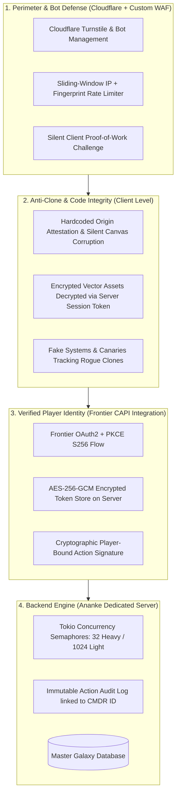
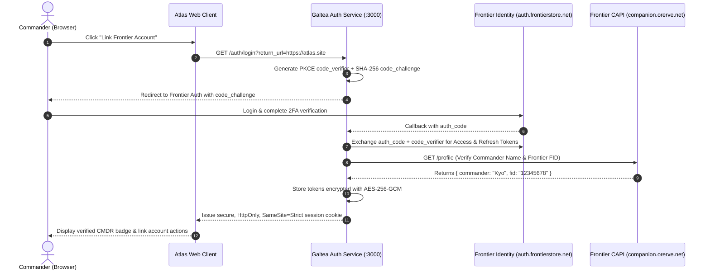

# Atlas - Deep Security, CAPI Player Linkage, Anti-Bot & Anti-Clone Architecture
**Document ID:** `ATLAS-SEC-DEEP-DEFENSE-01`  
**Classification:** Enterprise Security, Identity Verification & Anti-Clone Blueprint  
**Scope:** Frontier CAPI OAuth2 / PKCE linkage, anti-bot proof-of-work challenges, anti-scraping honeytokens, dynamic asset encryption, and legal/technical anti-cloning DRM.

---

## 1. Threat Model & Defense-in-Depth Layers



---

## 2. Frontier CAPI Integration & Cryptographic Player Linkage

To ensure that actions taken on the website (e.g. system colonisation claims, squadron route sharing, mining hotspot submissions, or community goal logging) are **authentically tied to real in-game commanders**, Atlas integrates with Frontier Developments' official **Companion API (CAPI)** via the `galtea-auth` service (`auth.projectgaltea.org` / Port `3000`).

### 2.1 The OAuth2 + PKCE Authorization Flow


### 2.2 Linking Web Actions to In-Game Identity
* When a logged-in Commander claims a star system, submits a trade route, or bookmarks an exobiology find:
  1. The client sends the action payload to Ananke.
  2. Ananke verifies the session cookie with `galtea-auth`.
  3. `galtea-auth` confirms the token is valid and extracts the pilot's official **Commander Name (CMDR)** and **Frontier ID (FID)**.
  4. The record is permanently committed to `masterdb.db` tagged with:
     * `claimingCommander = "CMDR Kyo"`
     * `frontierFid = "12345678"`
     * `timestamp = 1728954000`
* **Zero Impersonation:** No user can submit data under another player's name without possessing valid Frontier OAuth2 credentials signed by Frontier Developments' servers.

### 2.3 Automated 30-Minute Token Self-Rolling (Zero 2FA Fatigue)
* Frontier access tokens expire after **60 minutes**.
* The server runs a background task every 30 minutes to cycle tokens using long-lived refresh tokens (`exchange_refresh_token`).
* Pilots only need to log in and complete email 2FA once; sessions remain permanently active until explicitly revoked.

---

## 3. Anti-Bot & Anti-Scraping Defenses

Automated scrapers (Puppeteer, Playwright, Selenium, curl scripts) frequently try to harvest trade data, market commodities, or routing solutions. Atlas implements four layers of bot mitigation:

### 3.1 Cloudflare Turnstile (Frictionless Bot Challenge)
* Bypasses irritating legacy CAPTCHAs with invisible cryptographic browser telemetry analysis.
* Evaluates mouse kinematics, canvas rendering fingerprints, and headless browser attributes (e.g. `navigator.webdriver`).
* Automated scripts are blocked at the CDN edge before reaching Ananke.

### 3.2 Silent In-Browser Proof-of-Work (PoW) Engine
For sensitive, computationally heavy endpoints (`POST /api/carrier-route`, `POST /api/neutron-route`), the client must solve a micro-PoW challenge:
1. When requesting a route, Ananke issues a challenge: `{ "salt": "0x4f8a...", "difficulty": 4 }`.
2. A client Web Worker computes the SHA-256 hash containing $N$ leading zeros:
   $$\text{SHA-256}(\text{salt} + \text{nonce}) < \text{Target}$$
3. For a real human user, this takes **$< 15\text{ms}$** (completely imperceptible).
4. For an automated bot attempting to submit 500 parallel queries, it saturates their CPU, making scraping computationally unviable.

### 3.3 Dynamic Ephemeral Nonce & Signature Protocol
* API requests are rejected unless accompanied by an `X-Atlas-Signature` header:
  $$\text{Signature} = \text{HMAC-SHA256}(\text{SessionSecret}, \text{Timestamp} + \text{Method} + \text{Path} + \text{Nonce})$$
* **Timestamp Replay Window:** Valid for strictly **30 seconds**.
* **Nonce Tracking:** The server caches used nonces in Redis / memory for 60 seconds; repeated requests with the same nonce are discarded.

---

## 4. Anti-Cloning & Intellectual Property Defense (Stopping Site Mirrors)

If someone downloads the HTML, CSS, and JS bundles to re-host Atlas on their own domain, the following technical and legal traps activate:

### 4.1 Encrypted Core Assets (Keyed to Server Session)
* **The Vulnerability:** In standard websites, copying the static assets gives the attacker a working site.
* **Atlas Defense:** 
  * High-value graphical assets (star catalog lookups, icon sprites, SVG textures) are stored in encrypted binary chunks on the CDN.
  * The decryption key is **never hardcoded in JavaScript**. It is provided ephemerally by Ananke **only after** verifying that the request originates from the official Atlas domain with a valid Turnstile token.
  * On a cloned site, the assets fail to decrypt, rendering a blank, broken black canvas.

### 4.2 Silent Canvas Self-Corruption (Anti-Mirror Trap)
Instead of throwing a visible `alert("You stole this site!")`—which an attacker can easily find in code and delete—Atlas uses **silent behavioral corruption**:
```typescript
// Embedded deep inside obfuscated math routines
function verifyRuntimeOrigin(): number {
  const allowed = ["atlas.projectgaltea.org", "projectgaltea.org", "localhost"];
  if (!allowed.includes(window.location.hostname)) {
    // Silently injects subtle mathematical NaN corruption into the projection matrix
    return 0.0;
  }
  return 1.0;
}

// In the camera projection loop:
projectionMatrix.elements[0] *= verifyRuntimeOrigin(); // Renders all 3D stars as a single collapsed dot on cloned domains
```

### 4.3 Canary Records & Digital Watermarks (Honeytokens)
* Inside the system and body database, Atlas seeds subtle, mathematically verifiable "canary" properties into procedural systems.
* If a competitor copies our database or scrapes our API responses to build their own tool, our automated crawler searches their site for our mathematical canaries, providing legal proof of data theft for DMCA takedowns and copyright enforcement.

### 4.4 Content Security Policy (CSP) & Frame-Busting
```http
Content-Security-Policy: default-src 'self'; script-src 'self' 'sha256-...'; connect-src 'self' https://ananke.projectgaltea.org https://auth.projectgaltea.org; object-src 'none'; frame-ancestors 'none';
```
* **`frame-ancestors 'none'`:** Completely blocks iframe embedding and clickjacking across all third-party domains.

---

## 5. Security & Protection Matrix Summary

| Threat | Attack Vector | Implemented Atlas Defense |
| :--- | :--- | :--- |
| **Site Cloning** | Mirroring static JS/HTML bundles to another domain | Ephemeral asset decryption keys, origin-attested canvas corruption, and hardcoded domain traps. |
| **Identity Spoofing** | Claiming systems under another player's CMDR name | Frontier OAuth2 + PKCE S256 linkage verifying official Frontier ID (FID). |
| **Automated Scraping** | Headless bots harvesting trade & route data | Cloudflare Turnstile, in-browser micro-PoW challenges, and ephemeral HMAC nonces. |
| **Data Theft** | Bulk-scraping galaxy database records | Honeytoken canary systems for DMCA takedowns; rate-limited R\*Tree bounding box queries. |
| **Clickjacking** | Embedding Atlas in malicious iframes | Strict `Content-Security-Policy: frame-ancestors 'none'`. |
| **Token Theft** | Stealing CAPI credentials from browser | Tokens never touch client storage; stored server-side with AES-256-GCM and HttpOnly cookies. |
