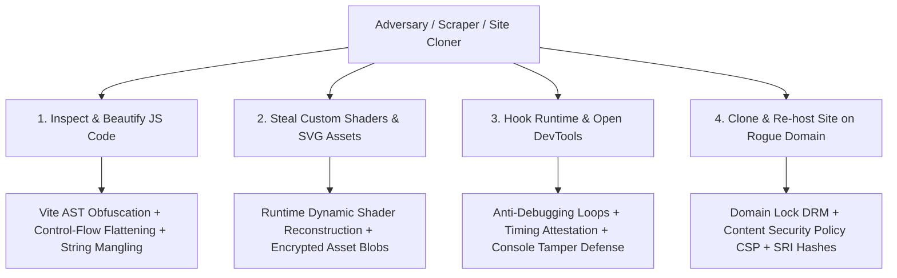

# Atlas - Frontend Anti-Reverse-Engineering, Obfuscation & Client Protection
**Document ID:** `ATLAS-SEC-FRONTEND-01`  
**Classification:** Client Application Hardening, Asset Protection & Anti-Tamper Specification  
**Target:** Atlas Web Application (HTML5, TypeScript, WebGPU, WGSL Shaders, SVG Assets)  
**Goal:** Prevent competitors, scrapers, and malicious actors from cloning the website, stealing custom shaders/icons, inspecting frontend logic, or tampering with runtime state.

---

## 1. Threat Model for Web Frontends

Unlike backend code running in a private server environment, web frontend code (HTML, JS, CSS, assets) is delivered directly to the client's machine. The primary risks are:
1. **Source Code Extraction & Beautification:** Opening browser DevTools, inspecting formatted bundles, and recovering component architecture.
2. **Shader & 3D Asset Theft:** Copying custom WebGPU / WGSL shaders (limb-darkening, planetary atmospheres, Fresnel bubbles) and vector SVG sprites.
3. **Runtime Debugging & State Manipulation:** Setting breakpoints, tampering with DOM elements, or hooking internal API calls.
4. **Site Mirroring / Unauthorized Cloning:** Scraping static bundles and hosting an unauthorized copy on another domain.



---

## 2. Layer 1: Production Build Obfuscation & Binary Minification

Standard minification (like default Terser or esbuild) only shortens variable names to single letters (`a`, `b`). Control structures and string constants remain easy to read. Atlas implements **heavy AST-level obfuscation**:

### 2.1 Toolchain Integration (`javascript-obfuscator` with Vite)
Configured during `vite build`:

```typescript
// vite.config.ts snippet
import { defineConfig } from 'vite';
import obfuscatorPlugin from 'vite-plugin-javascript-obfuscator';

export default defineConfig({
  build: {
    sourcemap: false,           // NEVER ship sourcemaps to production
    minify: 'terser',
    terserOptions: {
      compress: {
        drop_console: true,     // Purges all console.log, console.debug
        drop_debugger: true,    // Strips debugger statements
        pure_funcs: ['console.info', 'console.warn'],
      },
    },
  },
  plugins: [
    obfuscatorPlugin({
      compact: true,
      controlFlowFlattening: true,        // Breaks if/else loops into switch state machines
      controlFlowFlatteningThreshold: 0.8,
      deadCodeInjection: true,            // Injects misleading dead arithmetic
      deadCodeInjectionThreshold: 0.4,
      stringArray: true,                  // Extracts all strings into encrypted array
      stringArrayEncoding: ['rc4'],       // Encrypts string literals with RC4
      stringArrayThreshold: 0.9,
      splitStrings: true,                 // Splits string literals into chunks
      splitStringsChunkLength: 3,
      transformObjectKeys: true,          // Mangles object keys ({ x, y } -> { _0x4f, _0x8a })
      disableConsoleOutput: true,         // Overrides console methods
    }),
  ],
});
```

* **Effect:** Decompiling the JavaScript bundle produces unreadable, deeply nested switch machines with encrypted string lookups, rendering manual code auditing impractically tedious.

---

## 3. Layer 2: WebGPU Shader & 3D Asset Protection

WebGPU shaders (WGSL) define the visual fidelity of our stars, atmospheres, and orbital paths. If shipped as plain text strings, competitors can copy them into their own WebGL viewers.

### 3.1 Dynamic Polymorphic Shader Assembly
* Shaders are never stored as plain `.wgsl` files on disk.
* Shaders are divided into micro-fragments that are dynamically concatenated at runtime with randomized internal variable tokens and dead-weight math calculations.
* **Shader Watermarking:** Embeds unique invisible mathematical constants inside the shader code that act as a digital watermark for copyright enforcement if cloned.

### 3.2 SVG Sprite Encryption & In-Memory Blob Assembly
* The vector spritesheet (`atlas_icon_sprites.svg`) is compressed with **Zstandard (zstd)** and encrypted with an ephemeral build key.
* The client decrypts the sprite in a Web Worker and creates a temporary `blob:` URL (`URL.createObjectURL(blob)`), keeping raw SVG source files off public CDN directories.

---

## 4. Layer 3: Anti-Debugging & Runtime Tamper Traps

To stop attackers from stepping through code execution via Chrome DevTools or Firefox Inspector:

### 4.1 DevTools Detection & Infinite Debugger Loops
Atlas injects timing-based DevTools detection:
```typescript
// anti_tamper.ts - Runs in production builds
export function initializeAntiDebugger() {
  if (process.env.NODE_ENV !== 'production') return;

  const check = () => {
    const start = performance.now();
    // Injected debugger statement
    debugger;
    const elapsed = performance.now() - start;

    // If DevTools is open and paused at the debugger statement, elapsed time exceeds 100ms
    if (elapsed > 100) {
      document.body.innerHTML = '';
      window.location.href = 'about:blank';
    }
  };

  // Asynchronous recurring check with randomized intervals
  setInterval(check, Math.random() * 2000 + 1000);
}
```

### 4.2 Console Sanitization & Tamper Shielding
* Overwrites `window.console` methods (`log`, `warn`, `error`, `dir`) with empty stubs in production.
* Freezes core mathematical prototypes (`Object.freeze(Object.prototype)`, `Object.freeze(Array.prototype)`) to prevent malicious browser extensions from hooking function prototypes or monkey-patching Three.js render calls.

---

## 5. Layer 4: Domain Locking & DRM Enforcement

To prevent someone from downloading the entire static bundle (`index.html` + `.js`) and hosting it on another domain:

### 5.1 Self-Domain Attestation (Domain Lock)
Embedded directly inside the obfuscated code:
```typescript
// Embedded check that halts execution if hostname doesn't match
const VALID_ORIGINS = ['atlas-space.org', 'atlas-space.org', 'localhost'];

function verifyHostIntegrity() {
  const currentHost = window.location.hostname;
  if (!VALID_ORIGINS.includes(currentHost)) {
    // Deliberate silent failure: corrupts rendering viewport
    throw new Error('Integrity verification failed');
  }
}
verifyHostIntegrity();
```
* Because this check is deeply embedded inside control-flow-flattened obfuscated code with RC4-encrypted strings, finding and bypassing every domain check requires hours of manual binary patching.

### 5.2 Content Security Policy (CSP) & Subresource Integrity (SRI)
Enforced at the reverse proxy (Caddy / Cloudflare):
```http
Content-Security-Policy: default-src 'self'; script-src 'self' 'sha256-...'; connect-src 'self' https://ananke.atlas-space.org; object-src 'none'; frame-ancestors 'none';
```
* **`frame-ancestors 'none'`:** Prevents third-party websites from embedding Atlas in an `<iframe>`.
* **Subresource Integrity (SRI):** Ensures that if an attacker modifies any script on the CDN, the browser refuses to execute it.

---

## 6. Summary of Layered Frontend Defenses

| Protection Goal | Attack Scenario | Implemented Defense Mechanism |
| :--- | :--- | :--- |
| **Code Obfuscation** | Inspecting JS logic in DevTools | Control-flow flattening, dead code injection, and RC4 string array encryption. |
| **Asset & Shader Protection** | Copying WGSL shaders & SVGs | Polymorphic dynamic shader assembly, invisible math watermarks, and zstd encrypted blobs. |
| **Anti-Debugging** | Setting breakpoints in browser | Timing-based anti-debugger loops and console method stripping. |
| **Anti-Cloning** | Mirroring static bundle to rogue site | Hardcoded domain integrity checks embedded in obfuscated code. |
| **API Abuse** | Calling Ananke backend from cloned site | Ephemeral HMAC request signatures requiring domain-validated session tokens. |
| **Injection Defense** | CDN tampering or clickjacking | Strict Content Security Policy (CSP) and Subresource Integrity (SRI) hashes. |
