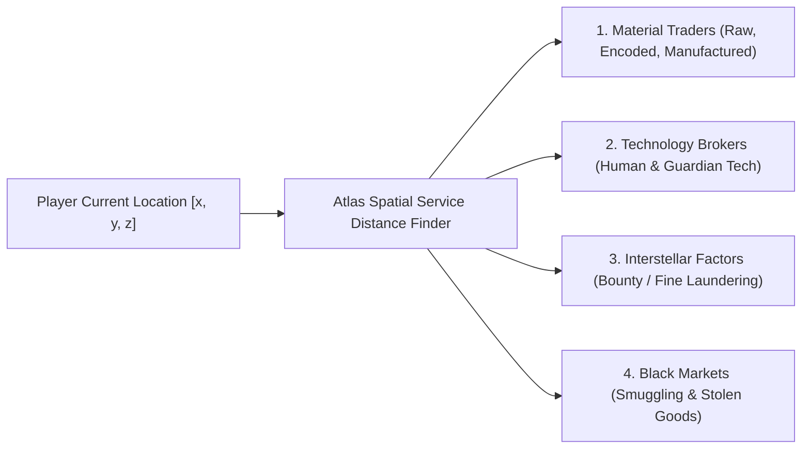

# Atlas - Frontier Services, Underworld & Specialized Capabilities
**Complementary Ecosystem:** Inara Services, EDSM Trilateration, EDMC Automation, Frontier API (CAPI), and Fleet Logistics  
**Target:** Identifying every specialized mechanic, station service, and data pathway to ensure Atlas leaves zero gaps.

---

## 1. Specialized Station Services & Infrastructure Finders

Beyond standard refuel and outfitting, Elite Dangerous features specialized station contacts that players frequently travel hundreds of light years to find:

### 1. Material Traders (Raw, Encoded, Manufactured)
* In Elite Dangerous, materials trade within categories at specific exchange rates (e.g., $1 \times \text{Grade 5} = 3 \times \text{Grade 4} = 81 \times \text{Grade 1}$).
* **Atlas Capability:** A one-click **"Nearest Material Trader"** filter that breaks down traders by their specific category:
  * **Raw Material Trader:** Found at Extraction / Refinery economies.
  * **Manufactured Material Trader:** Found at Industrial / High Tech economies.
  * **Encoded Data Trader:** Found at High Tech / Military economies.
  * Includes an interactive **Cross-Trade Calculator** that determines how many materials you need to trade down/up to complete an engineering blueprint.

### 2. Technology Brokers (Human & Guardian Unlocks)
* Unlocking specialized gear: Guardian FSD Boosters, Guardian Shield Reinforcements, Pre-Engineered FSDs (v1 5A), Anti-Xeno AX Missiles, Enhanced AX Multi-cannons.
* **Atlas Capability:** Tech Broker unlock matrix showing:
  * Exactly what components you still need in your inventory.
  * Nearest starport with a Human or Guardian Technology Broker.
  * Nearest Guardian Ruin sites to farm Guardian Technology Blueprints, Weapon Blueprints, and Guardian Power Cells.

### 3. Interstellar Factors & Legal Laundering
* When a Commander incurs bounties or fines from accidental friendly fire or illegal missions, local authorities lock station services.
* **Atlas Capability:** **"Nearest Interstellar Factors"** locator that:
  * Filters for star systems with low security or anarchy states where Interstellar Factors are present.
  * Filters out systems where the issuing minor faction is currently present (avoiding the in-game limitation where an Interstellar Factor cannot clear a bounty if the claiming faction is in the local system).

### 4. Black Markets & Smuggling Profit Engine
* Selling stolen cargo, salvage from wreckage, or prohibited commodities.
* **Atlas Capability:** Highlights stations with active black markets within range of your current salvage location, calculating smuggling profit margins while flagging high-security starports with security patrol vessel density.

---

## 2. Odyssey On-Foot Concierge & Settlement Infiltration

Odyssey introduced ground settlements with restricted access clearances, data terminals, and specialized vendors:

### 1. Pioneer Supplies Vendor & Pre-Upgraded Gear Scout
* Every Thursday after the server tick, starport Pioneer Supplies shops randomly stock **pre-engineered Grade 2 and Grade 3 suits and weapons** (e.g., Dominator G3 with Faster Shield Regen, Maverick G3 with Extra Backpack Capacity).
* **Atlas Capability:** A live, crowd-sourced **"Pioneer Gear Tracker"** showing recently discovered G2/G3 suit/weapon locations before other commanders purchase them.

### 2. Settlement Security Clearances & Terminal Layouts
* Odyssey settlements have security authorization levels: Level 0 (Public), Level 1 (Maintenance), Level 2 (Operations), Level 3 (Command / Reactor).
* **Atlas Capability:** Interactive 2D architectural blueprints for major Odyssey settlement archetypes (Extraction, Industrial, Agriculture, Research, Military), showing:
  * Power Regulator housing location.
  * Alarm disable terminal.
  * Data download access points for manufacturing assets.

---

## 3. Powerplay 2.0 Dynamic War Room (New Update Mechanics)

With the Powerplay 2.0 overhaul, territorial play is radically more active:
* **Atlas Capabilities:**
  * **Stronghold & Exploitation Radii Visualizer:** Dynamic 3D interactive bubbles showing the exact push/pull influence curves between opposing Powers.
  * **Weekly Merit Task Tracker:** Prioritizes systems based on current merit multipliers (e.g., Rare Good deliveries, Undermining kills, Propaganda distribution).
  * **Power Acquisition Leaderboards:** Live standings of all 11+ Powers (Aisling, Hudson, Winters, Torval, Grom, Mahon, etc.) with real-time net-gain territory forecasts.

---

## 4. Frontier Companion API (CAPI) Direct Cloud Sync

While reading local journal files works on PC, web-only or console/cloud players cannot access local disk files.
* **Atlas Direct CAPI Integration:**
  * Uses OAuth2 authentication with Frontier Developments' official Companion API (`https://companion.orerve.net/` or Frontier Auth Service).
  * Fetches the Commander's profile, credits balance, current ship loadout, location, and stored fleet directly from Frontier servers in real time.
  * Allows Atlas to function on mobile phones, iPads, Mac, and Chromebooks with zero local software installed.

---

## 5. Summary of the Complete Atlas Suite

| Traditional Standalone Tool | In-Atlas Integrated Module |
| :--- | :--- |
| **Inara Markets & Trade** | Integrated spatial commodity trade loops & profit-per-hour navigator. |
| **Spansh Neutron / Carrier Plotter** | 3D interactive trajectory curves with fuel stops & clipboard auto-copy. |
| **EDAstro Exploration Maps** | GPU-raymarched volumetric heatmaps & DSSA deep-space fleet overlay. |
| **Raven Colonial Depot Tracker** | System Map Architect View with colonisation BOM & market radius finder. |
| **Coriolis / EDSY Ship Builder** | Interactive 3D ship outfitter with shield EHP and thermal DPS calculations. |
| **EDMC / EDDI Voice & Plugins** | Real-time synthetic COVAS audio assistant & glide corridor guidance. |
| **Material Trader / Tech Broker Finders** | One-click nearest contact locator with category & cross-trade calculators. |
| **Pioneer Supplies G3 Scout** | Crowdsourced pre-upgraded Odyssey suit and weapon locator. |
| **Frontier CAPI Cloud Auth** | Zero-install cloud synchronization for mobile and browser-only users. |
