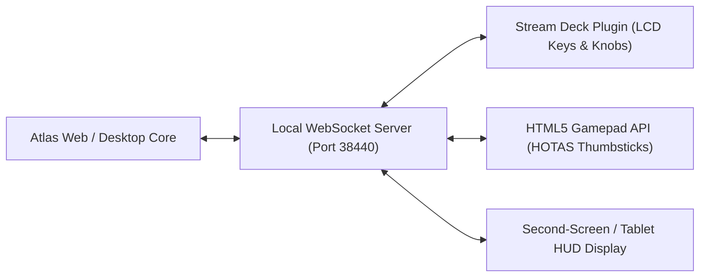
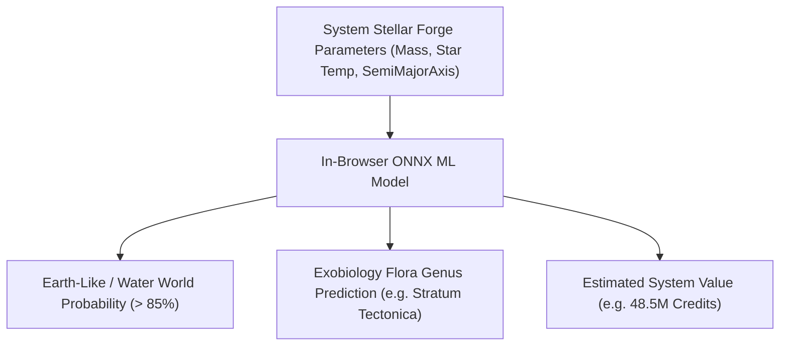

# Atlas - Hardware Integration, Physical Cockpits & AI Flight Intelligence
**Scope:** Bridging Atlas with physical hardware (HOTAS, Elgato Stream Deck, Cockpit Displays), Predictive AI, and Seamless Multi-Monitor Setups.

---

## 1. Elgato Stream Deck & Cockpit Hardware Integration

In modern flight simulator setups, commanders rely on dedicated physical hardware (Stream Decks, button boxes, Virpil/VKB HOTAS throttles). Atlas bridges directly to physical peripherals:

### 1.1 Stream Deck Cartographic Integration:
* **Interactive Dynamic LCD Keys:**
  * **Current System Key:** Displays the active system name, security level, and primary star class. Tapping centers Atlas on the star.
  * **Next Waypoint Key:** Shows the next jump destination and remaining jumps. Tapping copies the name to the clipboard.
  * **Carrier Jump Countdown Key:** Displays live remaining minutes/seconds until your Fleet Carrier departs.
  * **Fuel Indicator Key:** Shows current fuel percentage and warns if the next star is unscoopable.
* **Rotary Encoders (Stream Deck +):**
  * Knob 1: Real-time time scrubbing forward/backward in the 3D Orrery.
  * Knob 2: Logarithmic zoom in/out in the 3D Galaxy Map.

---

## 2. Native HOTAS & Gamepad Navigation (HTML5 Gamepad API)

When wearing a VR headset or flying hands-on with a HOTAS (Hands On Throttle And Stick), reaching for a mouse is immersion-breaking.
* Atlas natively integrates the **HTML5 Gamepad API**:
  * **Analog Thumbstick 1 (Pitch/Yaw/Roll):** Rotates the 3D Galaxy and Orrery camera smoothly with deadzone filtering.
  * **Analog Thumbstick 2 (Pan X/Z):** Pans the galactic grid plane.
  * **Throttle Analog Axis:** Smoothly controls camera elevation (crane height) or logarithmic zoom.
  * **Hat Switch (POV):** Snaps between major UI tabs (Galaxy $\rightarrow$ System $\rightarrow$ Orrery $\rightarrow$ Dossier).

---

## 3. Real-Time Predictive AI Exploration Assistant

Using lightweight in-browser machine learning (ONNX Runtime Web / WebAssembly):

### 3.1 Predictive Capabilities:
1. **Unscanned High-Value Body Prediction:**
   * Upon jumping into a system and triggering the "Honk" (Discovery Scanner), Atlas analyzes primary star temperature, stellar mass, and orbital spacing.
   * Predicts which unexplored orbital bodies are inside the circumstellar **Goldilocks Habitable Zone** before the Commander flies thousands of LS to scan them.
2. **Atmospheric Exobiology Flora Predictor:**
   * Compares atmospheric composition ($CO_2$, Argon, Nitrogen, Methane), surface temperature, and gravity against planetary catalog models to predict exactly which flora species exist on the surface.

---

## 4. Multi-Monitor Split-Screen Cockpit Matrix

Instead of cramming everything into one window, Atlas supports **Multi-Window Broadcast Channel Synchronization (`BroadcastChannel` API)**:

* **Monitor 1 (Main Display):** Elite Dangerous 4K gameplay.
* **Monitor 2 (Left Screen):** Full-screen 3D Galaxy Map with live plotted route and Powerplay bubbles.
* **Monitor 3 (Right Screen / Tablet):** Live 2D System Map & 3D Keplerian Orrery showing real-time planetary positions and station orbits.
* **Zero Performance Impact on Game:** Runs asynchronously on separate GPU viewports, communicating via zero-latency local memory broadcasts.

---

## 5. Automated Expedition Journal & Flight Log Export

* **Automated Logbook Generator:**
  * Generates a timeline of your expedition: Total light years traveled, maximum distance from Sol, total systems visited, first discoveries logged, and total credits earned.
* **Interactive 3D Web Embeds:**
  * One-click "Share My Flight Path": Generates an interactive 3D URL that friends or squadmates can open in any browser to inspect your 3D flight trajectory and screenshots.
* **Export Formats:**
  * Direct export to standard formats: **GeoJSON, KML (for 3D visualizers), CSV, and Spansh/EDSM sync**.
