# Atlas - In-Cockpit Native Client & Web Platform Bidirectional Integration Specification
**Document ID:** `ATLAS-SPEC-NATIVE-WEB-INTEGRATION-01`  
**Classification:** System Architecture & Data Topology Enhancement  
**Scope:** Defines how an in-cockpit native payload/overlay and the Atlas web cartography platform seamlessly interface, synchronize real-time flight telemetry, and share spatial databases without revealing internal implementation details.

---

## 1. Executive Summary & Integration Architecture

While Atlas functions as an ultra-high-performance web cartography and fleet management platform, its capabilities can be dramatically enhanced when paired with an **in-cockpit native client companion**.

By establishing a low-latency, secure local WebSocket/IPC and REST bridge, Atlas transforms from a static website into a **live flight computer**:
1. **Zero-Lag Telemetry Streaming:** 60 Hz positional coordinates, target leads, sub-target health, and orbital flight vectors stream directly to the web dashboard.
2. **Reverse Navigation & Waypoint Push:** Selecting any system, carrier depot, or planetary coordinate on the Atlas web map immediately injects the target into the in-game cockpit navigation computer with zero manual typing.
3. **Database Telemetry Logging & Real-Time Sync:** Automatically enriches the shared galaxy database with high-resolution planetary data, ring core strata, settlement layouts, and network latencies.

```mermaid
flowchart LR
    subgraph Cockpit ["In-Game Process / Native Payload"]
        Engine[DirectX 11 Present Loop & Memory Hooks]
        TelemetryCore[Avionics, Targeting & NetLog Core]
        LocalBridgeServer[Local WebSocket / HTTP Bridge :8999]
    end

    subgraph AtlasSite ["Atlas Web Cockpit (Browser / Tablet)"]
        WebClient[Atlas WebGPU Engine & HUD UI]
        LocalSyncWorker[Local WebSocket Client Listener]
    end

    subgraph CentralServices ["Atlas Central Backend (Ananke & MasterDB)"]
        AnankeAPI[Ananke Dedicated REST Daemon :8000]
        MasterDB[(masterdb.db / EDSM Cube)]
    end

    Engine --> TelemetryCore
    TelemetryCore --> LocalBridgeServer
    LocalBridgeServer <-->|Low Latency ws://127.0.0.1:8999| LocalSyncWorker
    LocalSyncWorker <--> WebClient
    WebClient <--> AnankeAPI
    AnankeAPI <--> MasterDB
```



---

## 2. Integrated Feature Matrix

### 2.1 Reverse Waypoint Injection & In-Cockpit Waypoint HUD
* **How it works:**
  * Commander clicks "Plot Route" on the Atlas website (e.g., Neutron Highway, Colonisation Material run, or High-G planet).
  * Atlas dispatches the target sequence via `POST http://127.0.0.1:8999/api/v1/nav/target`.
  * The native client intercepts the game's navigation target buffer or automatically triggers the game's target lock, instantly projecting the route onto the in-cockpit HUD reticle without manual search typing.

### 2.2 Dual-Screen Glass Cockpit & Touchscreen Pip Management
* **How it works:**
  * When Atlas is opened on an iPad, secondary monitor, or mobile device, it connects to the local bridge.
  * Tapping system sub-targets (e.g. *Power Plant*, *FSD Drive*) on the Atlas web UI sends an immediate sub-target cycling instruction to the in-game cockpit.
  * Tapping power presets ($4-2-0$, $0-4-2$, $2-4-0$) on the web interface directly adjusts in-cockpit power distribution pips.

### 2.3 Real-Time 3D Planetary Glide & High-G Touchdown Assistant
* **Web Feature:** Atlas displays real-time 3D elevation contours and optimal glide corridors (-6° to -60°).
* **Native Integration:**
  * The native client streams live vertical descent speed, surface gravity ($g$), and retro-thruster buffer margins to Atlas.
  * Atlas computes real-time terrain collision avoidance countdowns and audio-visual cues on the secondary display.

### 2.4 Deep Exobiology Colonial Distance Guard
* **Web Feature:** Shows required sample separation distance ($100\text{m} - 800\text{m}$) and Vista Genomics payout multipliers ($5\times$).
* **Native Integration:**
  * The native client tracks physical player on-foot coordinate displacement from sample #1.
  * When the pilot crosses the threshold boundary, Atlas chimes an audio alert and visualizes a green harvest circle on the planetary surface map.

### 2.5 Detailed Surface Scanner (DSS) Probe Trajectory Solver
* **Web Feature:** Calculates the exact angular launch vectors for planetary mapping probes to achieve 100% surface coverage with the minimum probe bonus.
* **Native Integration:**
  * Native client feeds the exact planetary radius, distance, and camera FOV to the web solver.
  * The web UI projects the exact probe aim crosshairs onto the secondary screen in real time.

### 2.6 Multi-Instance Fleet & Carrier Synchronization
* **How it works:**
  * For commanders running multi-instance fleet setups, the native client distinguishes instances via separate isolated ports or account IDs.
  * Atlas allows switching between active ships in the top HUD dropdown, showing real-time fuel, cargo, and jump readiness across the entire squadron fleet simultaneously.

---

## 3. Database Schema Extensions & Logging Pipeline

To support the rich data generated by the native-to-web telemetry pipeline, the central database (`masterdb.db`) can be additively enhanced with the following optional tables:

### 3.1 `cockpit_telemetry_logs`
Logs high-value flight data, travel durations, and supercruise flight times between systems:
```sql
CREATE TABLE IF NOT EXISTS cockpit_telemetry_logs (
    log_id INTEGER PRIMARY KEY AUTOINCREMENT,
    commander_fid TEXT NOT NULL,
    system_id64 TEXT NOT NULL,
    ship_type TEXT NOT NULL,
    jump_duration_seconds REAL,
    fuel_consumed_tons REAL,
    network_latency_ms INTEGER,
    recorded_at INTEGER NOT NULL
);
CREATE INDEX IF NOT EXISTS idx_telemetry_system ON cockpit_telemetry_logs(system_id64);
```

### 3.2 `settlement_security_layouts`
Stores mapped layouts of Odyssey ground settlements (clearance levels, power regulators, camera angles):
```sql
CREATE TABLE IF NOT EXISTS settlement_security_layouts (
    settlement_id INTEGER PRIMARY KEY AUTOINCREMENT,
    system_id64 TEXT NOT NULL,
    body_id INTEGER NOT NULL,
    settlement_name TEXT NOT NULL,
    government_type TEXT NOT NULL,
    clearance_level_required INTEGER DEFAULT 0,
    reactor_containment_type TEXT,
    terminal_count INTEGER DEFAULT 0,
    last_surveyed_timestamp INTEGER NOT NULL
);
CREATE INDEX IF NOT EXISTS idx_settlement_system ON settlement_security_layouts(system_id64);
```

### 3.3 `asteroid_fissure_surveys`
Caches deep-core mining fissure compositions and detonation efficiency metrics:
```sql
CREATE TABLE IF NOT EXISTS asteroid_fissure_surveys (
    survey_id INTEGER PRIMARY KEY AUTOINCREMENT,
    system_id64 TEXT NOT NULL,
    body_id INTEGER NOT NULL,
    ring_name TEXT NOT NULL,
    mineral_name TEXT NOT NULL,
    fissure_strength_profile TEXT, -- JSON: {"low": 2, "avg": 3, "high": 1}
    optimal_yield_tons REAL,
    discovered_by_cmdr TEXT NOT NULL,
    created_at INTEGER NOT NULL
);
CREATE INDEX IF NOT EXISTS idx_fissures_system_mineral ON asteroid_fissure_surveys(system_id64, mineral_name);
```

---

## 4. Local WebSocket Bridge Protocol Specification

The local companion bridge operates on `ws://127.0.0.1:8999/telemetry`:

### 4.1 Packet Types: Inbound (Native $\rightarrow$ Web)
```typescript
interface LiveAvionicsTelemetryPacket {
  type: "AVIONICS_UPDATE";
  timestamp: number;
  ship: {
    hull_percent: number;
    shield_percent: number;
    heat_percent: number;
    pips: [number, number, number]; // [SYS, ENG, WEP]
    speed_ms: number;
    altitude_m?: number;
    gravity_g?: number;
  };
  navigation: {
    system_id64: string;
    system_name: string;
    target_body_id?: number;
    supercruise: boolean;
    glide_active: boolean;
  };
  targeting?: {
    target_name: string;
    distance_m: number;
    subtarget_name?: string;
    subtarget_health_percent?: number;
  };
}
```

### 4.2 Packet Types: Outbound (Web $\rightarrow$ Native)
```typescript
interface WebCommandPacket {
  type: "SET_NAV_TARGET" | "SET_PIPS" | "SET_SUBTARGET";
  payload: {
    system_name?: string;
    system_id64?: string;
    pips?: [number, number, number];
    subtarget?: "POWER_PLANT" | "DRIVES" | "FSD";
  };
}
```

---

## 5. Security & Isolation Invariants

1. **Local-Only Binding:** The bridge server binds exclusively to `127.0.0.1` and `::1`. It never listens on external network interfaces.
2. **CORS / Origin Guard:** The native bridge only accepts WebSocket handshakes from `http://localhost:5173` or `http://localhost:*`.
3. **Graceful Fallback:** If the native bridge is not running, Atlas smoothly falls back to standard CAPI polling and HTML5 File System Access (`Status.json`) with zero user disruption.
