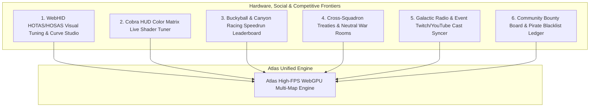

# Atlas - Social, Competitive & Hardware Ecosystem Blueprint
**Document ID:** `ATLAS-SPEC-SOCIAL-HARDWARE-01`  
**Classification:** Strategic Feature Blueprint & Hardware/Community Integration  
**Objective:** Detail unaddressed social, competitive, and hardware dimensions: Native HOTAS/HOSAS Calibration, In-Game HUD Matrix Color Customizer, Racing/Buckeyball Speedrun Leaderboards, Cross-Squadron Diplomatic War Rooms, and Real-Time Event Livestreams.

---

## 1. The Untapped Dimensions: Beyond Navigation & Data

While existing platforms focus on data tables, Elite Dangerous pilots have deep needs in **hardware configuration, visual personalization, competitive sports, and inter-squadron diplomacy**:

---

## 2. Advanced Feature Specifications

### Feature 1: WebHID HOTAS/HOSAS Joystick Calibration & Response Curve Studio
* **The Problem:** Setting up flight sticks (VKB, Virpil, Thrustmaster Warthog, Winwing) requires third-party calibration tools and complex XML edits.
* **Atlas Innovation:**
  * Uses the **WebHID API** to detect connected flight sticks, throttles, and rudder pedals directly in the browser.
  * **Interactive Response Curves:** Adjust deadzones, exponential sensitivity curves, and s-curves with real-time visual input ballistics.
  * **1-Click XML Export:** Exports custom joystick curves directly into the game's `Bindings/Custom.4.0.binds` file via the local bridge or HTML5 file save.

---

### Feature 2: In-Game HUD Theme Matrix & Custom Color Preset Studio (EDHM Parity)
* **The Problem:** The default amber-orange HUD can be fatiguing. Customizing HUD colors previously required third-party injector mods (EDHM) or manual `GraphicsConfigurationOverride.xml` RGB matrix math.
* **Atlas Innovation:**
  * **Live 3D Cockpit Preview:** Renders an interactive WebGPU 3D cockpit interior.
  * Adjust HUD RGB transformation matrices and see the exact cockpit reticles, radar spheres, and panel holographic colors update in real time.
  * **Preset Library:** 1-click popular presets (*Imperial Blue*, *Fed Tactical Cyan*, *Deep Stealth Red*, *Outlaw Violet*, *Retro Green*).
  * 1-click write to `GraphicsConfigurationOverride.xml`.

---

### Feature 3: Buckyball Racing Club & Canyon Speedrun Telemetry Leaderboards
* **The Problem:** Competitive canyon racers and long-range Buckyball endurance pilots (e.g. Sol to Sag A* speedruns) have to manually upload video recordings and forum screenshots.
* **Atlas Innovation:**
  * **Automated Telemetry Verification:** The native bridge or journal streamer verifies start system, intermediate checkpoint flybys, and finish system timestamps with sub-second accuracy.
  * **3D Canyon Race Replayer:** Records 60 Hz 3D flight trajectories through planet canyons (FA-Off boosts, lateral drift vectors, G-force spikes).
  * Spectators can replay past race runs in full 3D from any camera angle directly in Atlas.

---

### Feature 4: Cross-Squadron Diplomatic War Rooms & Non-Aggression Pacts
* **The Problem:** Inara has individual squadron pages, but zero tools for multi-squadron coalitions (e.g. Operation Ida, Anti-Xeno Initiative, BGS alliances) to coordinate joint treaties.
* **Atlas Innovation:**
  * **Coalition War Rooms:** Squadrons form multi-clan alliances with shared tactical maps.
  * **Non-Aggression Zones (NAP):** Mark systems on the Galaxy Map as protected or neutral territories with designated mining or expansion rights.
  * **Incident Logging:** Auto-flags when an allied squadron commander fires upon or attacks another treaty member based on journal `PVPKill` or `UnderAttack` events.

---

### Feature 5: In-Game Radio Station & Live Community Stream Multi-View
* **The Problem:** Commanders love listening to community radio (Radio Sidewinder, Hutton Orbital Radio, Lave Radio) while flying, requiring separate background browser tabs.
* **Atlas Innovation:**
  * **Embedded Audio Streamer:** Built-in cockpit radio streaming Radio Sidewinder, Lave Radio, and Hutton Orbital broadcasts with volume ducking during combat.
  * **Live Twitch/YouTube Exploration Feeds:** When community expeditions or PvP tournaments go live, Atlas embeds a mini picture-in-picture player on the Galaxy Map showing the streamer's live coordinates.

---

### Feature 6: Player Bounty Board, Outlaw Blacklist & Escort Hires
* **The Problem:** In-game bounty hunting is limited to NPCs. Tracking notorious player gankers or hiring protective escorts for trade convoys has no structured platform.
* **Atlas Innovation:**
  * **Decentralized Bounty Board:** Commanders post credit rewards for eliminating notorious outlaws (verified through Frontier journal `PVPKill` logs).
  * **Security Heatmap:** Displays systems with high player interdiction and PvP murder rates over the last 24 hours.
  * **Escort Request Board:** Traders and miners can broadcast an escort contract, alerting nearby bounty hunters to fly wing protection for a percentage of trade dividends.

---

## 3. Implementation Matrix

| Feature | Primary Community Need | Technical Vector |
| :--- | :--- | :--- |
| **HOTAS/HOSAS Studio** | Flight stick deadzones & sensitivity | WebHID API + XML bindings exporter |
| **HUD Color Matrix Studio** | Customizing cockpit HUD colors | WebGPU 3D Cockpit Shader + XML Writer |
| **Buckyball Race Leaderboard** | Competitive speedrunning & canyon racing | High-precision journal timestamping & 3D telemetry replayer |
| **Squadron Diplomatic Hub** | Coalition treaties & BGS territory pacts | Multi-tenant squadron permission ACLs |
| **Integrated Radio Player** | In-flight radio & live community streams | Web Audio streaming + Twitch API |
| **Player Bounty Board** | Escort hiring & outlaw danger tracking | Verified CAPI PvPKill log ingestion |
