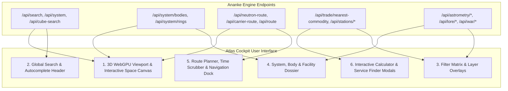

# Atlas - UI/UX Feature Specification: Translating Ananke Endpoints into Interactive Website Features
**Document ID:** `ATLAS-SPEC-UI-FEATURES-01`  
**Purpose:** Bridge backend Ananke REST endpoints directly into interactive, high-framerate website UI components, HUD overlays, drawers, and modal interactions.

---

## 1. Feature Architecture Overview

---

## 2. Interactive Website Feature Blueprint

### Feature 1: Global Smart Search & Deep Fly-To
* **Backed by:** `GET /api/search?q=`, `GET /api/system?name=`, `GET /api/system/estimate?name=`
* **UI Component:** Centered top HUD bar with keyboard hotkey (`/` or `Ctrl+K`).
* **Interactive Behavior:**
  * Displays instant dropdown (<2ms) grouping results by: Star Systems, Stations, POIs, and Lore Landmarks.
  * Shows star spectral badges (`G`, `O`, `Neutron`) and distance from Commander.
  * Selecting a system triggers a smooth **camera fly-to animation** ($2.5\text{s}$ cubic-bezier trajectory) into the 3D star coordinates, automatically dropping a perpendicular projection stalk to the galactic plane.
  * If the system is unvisited, smoothly calls `/api/system/estimate` to project procedural mass-code boxel coordinates.

---

### Feature 2: Dynamic 3D Frustum Streaming Viewport
* **Backed by:** `GET/POST /api/cube-search?x=&y=&z=&size=50`
* **UI Component:** WebGPU 3D canvas viewport.
* **Interactive Behavior:**
  * As the camera moves, Atlas debounces camera center coordinates into a spatial grid listener.
  * Queries a $50\text{ LY}$ bounding cube around the camera focus.
  * Appends newly visible stars into the GPU instanced vertex buffer without re-rendering the whole scene (Zero-stutter streaming).

---

### Feature 3: 2D System Hierarchy & 3D Interactive Orrery Mode
* **Backed by:** `GET /api/system/bodies`, `GET /api/system/rings`, `GET /api/astrometry/orbital-alignment`
* **UI Component:** Toggle button between **2D Schematic Tree** and **3D Keplerian Orrery**.
* **Interactive Behavior:**
  * **2D Tree View:** Renders left-to-right gravitational hierarchy with planetary icons, atmospheric glowing halos, and Horizons/Odyssey landable crescent arcs.
  * **3D Orrery View:**
    * Renders closed elliptical orbital splines (`THREE.LineLoop`) with eccentricity and inclination.
    * Real-time planetary positioning calculated from Keplerian elements.
    * **Time Scrubber Bar:** Slider at screen bottom allows dragging through time ($-30\text{ days}$ to $+30\text{ days}$) or playing at $1\times, 100\times, 1000\times$ speed to observe orbital mechanics.

---

### Feature 4: Visual Dual-Mode Route Planner
* **Backed by:** `POST /api/neutron-route`, `POST /api/carrier-route`, `POST /api/route`, `GET /api/navigation/supercruise-eta`
* **UI Component:** Bottom navigation drawer with "Neutron Highway", "Fleet Carrier", and "Standard FSD" tabs.
* **Interactive Behavior:**
  * Input source & destination (auto-populates player's current system).
  * **3D Route Curve:** Draws an animated glowing neon route line through the 3D galaxy with pulsating waypoint nodes.
  * **Neutron Hops:** Highlights neutron star systems in cyan with animated jet cones. Marks refueling stars in orange with "Fuel Stop" badges.
  * **Fleet Carrier View:** Displays total Tritium fuel consumed, jumps remaining, and 15-minute countdown clock markers.
  * **One-Click Clipboard Sync:** Clicking any waypoint copies the system name to the Windows clipboard for immediate `Ctrl+V` pasting inside Elite Dangerous.

---

### Feature 5: Galactic Density Heatmap Overlay
* **Backed by:** `GET /api/heatmap.png`
* **UI Component:** Left drawer layer toggle: *"Galactic Commander Activity Heatmap"*.
* **Interactive Behavior:**
  * Overlays the live $1024 \times 1024$ Inferno-colormap PNG as a textured plane at $Y = 0$.
  * Visualizes galactic travel density, active player hotspots (Sol, Colonia, Sag A*, Titan battlefields), and deep-space uncharted voids with smooth opacity blending.

---

### Feature 6: Specialized Contact & Service Modal Locator
* **Backed by:** `GET /api/stations/material-traders`, `GET /api/stations/tech-brokers`, `GET /api/stations/interstellar-factors`, `GET /api/stations/black-markets`, `GET /api/discount/shopping`
* **UI Component:** Quick-access toolbar buttons:
  * 🔄 **Material Traders:** Dropdown filter for Raw, Manufactured, or Encoded. Displays pad sizes and distance in LY from current location.
  * 🔬 **Tech Brokers:** Shows Human vs. Guardian brokers with one-click route plotting.
  * ⚖️ **Interstellar Factors:** Automatically hides systems where the player has local faction presence to ensure fines can be paid.
  * 💰 **Li Yong-Rui 15% Discounts:** Search for ships and outfitting modules with guaranteed discounts.

---

### Feature 7: Exobiology Assistant & Organic GPS Compass
* **Backed by:** `GET /api/exobiology/nearest-species`, `GET /api/bodies/nearest`
* **UI Component:** Mobile / Tablet companion card & right-hand drawer tab.
* **Interactive Behavior:**
  * Displays all biological species in the current star system.
  * Displays the Vista Genomics base value and first-discovery bonus multiplier ($5\times$).
  * Shows required clone sample separation distance ($100\text{m} - 800\text{m}$).
  * Connects to live player coordinates (`Status.json`) and sounds an audio chime when the player has walked/driven far enough to harvest sample #2 and #3.

---

### Feature 8: Mining Prospector & Ring Core Scanner
* **Backed by:** `GET /api/mining/hotspots`, `GET /api/mining/core-hotspots`, `GET /api/system/rings`
* **UI Component:** "Mining Hub" overlay.
* **Interactive Behavior:**
  * Filter by mineral (Platinum, Painite, Low Temperature Diamonds, Tritium).
  * Lists nearest rings with reserve levels (Pristine, Major) and ring types (Metallic, Icy).
  * System Map renders overlapping circles showing the exact geometrical zone where multiple hotspots intersect.

---

### Feature 9: Anti-Xeno War Room & Titan Meltdown Watch
* **Backed by:** `GET /api/war/thargoid/frontlines`, `GET /api/war/titan-graveyards`, `GET /api/war/spire-sabotage`
* **UI Component:** Red/Green high-contrast tactical map mode.
* **Interactive Behavior:**
  * Displays the 8 Titan Maelstroms with caustic perimeter spheres.
  * Active invasion progress bars for frontline systems.
  * Live **Titan Meltdown Countdown Timer** for Titans pushed into their death cycle.
  * Surface Spire sabotage mission markers.

---

### Feature 10: Colonisation Architect & System Claim Studio
* **Backed by:** `GET /api/colonization/prime-candidates`, `GET /api/colonization/system-slots`
* **UI Component:** System Map "Architect View" toggle.
* **Interactive Behavior:**
  * Renders interactive slots over planets and orbits for player-deployed orbital stations.
  * Calculates building material supply requirements (Titanium, Steel, Computer Components).
  * Evaluates virgin star systems for colonization suitability.

---

### Feature 11: "Galactic Wonders" Tourism & Record Tour Explorer
* **Backed by:** `GET /api/astrometry/*`, `GET /api/lore/*`, `GET /api/poi/*`
* **UI Component:** Discovery Codex drawer:
  * **Black Hole Tours:** Gravitational lensing preview.
  * **Extreme Gravity:** $>3g$ landing challenges.
  * **Polar Ring Worlds:** Planets with vertical ring planes ($>75^\circ$ axial tilt).
  * **Generation Ships & Guardian Ruins:** Lore audio transcript players and landmark coordinates.
  * One-click "Plot Expedition Tour to this Wonder".

---

## 3. Implementation Roadmap for Website UI Components

| UI Feature | Target Component Location | Ananke Backend Integration |
| :--- | :--- | :--- |
| **Search & Autocomplete** | `src/lib/components/TopSearchBar.svelte` | `GET /api/search`, `GET /api/system` |
| **3D Frustum Streaming** | `src/lib/engine/GalaxyViewport.svelte` | `POST /api/cube-search` |
| **System Map & Orrery** | `src/lib/components/SystemViewer.svelte` | `GET /api/system/bodies`, `GET /api/system/rings` |
| **Route Planner Drawer** | `src/lib/components/RoutePlannerDrawer.svelte`| `POST /api/neutron-route`, `POST /api/carrier-route` |
| **Service Finder Modal**| `src/lib/components/ServiceFinderModal.svelte`| `GET /api/stations/*`, `GET /api/trade/*` |
| **Exobiology Assistant** | `src/lib/components/ExobiologyCard.svelte` | `GET /api/exobiology/nearest-species` |
| **Mining Hotspot Map** | `src/lib/components/MiningHotspots.svelte` | `GET /api/mining/hotspots` |
| **AX Tactical Map** | `src/lib/components/AntiXenoWarRoom.svelte` | `GET /api/war/thargoid/frontlines` |
| **Architect System View**| `src/lib/components/ArchitectStudio.svelte` | `GET /api/colonization/*` |
| **Galactic Wonders Tour**| `src/lib/components/GalacticWonders.svelte` | `GET /api/astrometry/*`, `GET /api/lore/*` |
